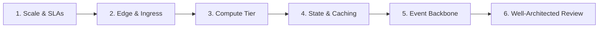

# Real-World AWS Architecture Blueprints & System Design Exercises

[](https://aws.amazon.com/architecture/well-architected/)
[]()
[]()
[]()

> A production-grade collection of real-world cloud architectures and system design exercises on Amazon Web Services (AWS). Each case study reverse-engineers well-known consumer applications (e.g., **Talabat**, **Careem**, **Netflix**, **Justlife**) to demonstrate how to design resilient, hyper-scale cloud platforms from first principles.

---

## 📚 Real-World Architecture Catalog

| # | Application | Domain | Key Architecture Patterns | Core AWS Services | Case Study |
| :---: | :--- | :--- | :--- | :--- | :---: |
| **01** | **Talabat** | Quick Commerce & Food Delivery | 3-Sided Marketplace, Geospatial Dispatch, Flash-Spike Leveling, Live Map Tracking | EKS, ElastiCache Redis (GEO), IoT Core, Step Functions, Aurora, DynamoDB | [Read Case Study ➔](cases/01-talabat-food-delivery/README.md) |
| **02** | **Careem** | Ride-Hailing & Super App | Uber H3 Hexagonal Spatial Index, Sub-Second Matchmaking, Real-Time Surge Pricing, ACID Ledger | Amazon MSK (Kafka), Apache Flink, MemoryDB, DynamoDB, Aurora PostgreSQL | [Read Case Study ➔](cases/02-careem-ride-hailing/README.md) |
| **03** | **Netflix** | Planetary VOD & Streaming | Massively Parallel Chunk Transcoding, Multi-Region Active-Active DR, Playback Sync, Edge CDN | CloudFront, AWS Batch, DynamoDB Global Tables, Route 53 ARC, SageMaker | [Read Case Study ➔](cases/03-netflix-video-streaming/README.md) |
| **04** | **Justlife** | On-Demand Home Services | High-Concurrency Slot Availability, Distributed Locking, Multi-Day Workflow Orchestrator, Subscriptions | Step Functions, EventBridge Scheduler, ECS Fargate, Redis Bitmaps, Aurora | [Read Case Study ➔](cases/04-justlife-home-services/README.md) |

---

## 🎯 What's Inside Every Case Study?

Each use case is structured as an interactive **System Design Exercise**:
1. **Business & Engineering Context**: Problem statement, user personas, and real-world domain challenges.
2. **Scale & Quantitative Constraints**: Daily active users (DAU), peak QPS, network throughput, and SLA targets (p99 latency, availability).
3. **Interactive Mermaid Architecture Diagrams**: Comprehensive system blueprints that render natively in GitHub.
4. **AWS Service Matrix & Trade-offs**: Deep justification for choosing specific AWS services over alternatives.
5. **Critical Flow Sequence Diagrams**: Step-by-step transaction walkthroughs (e.g., order dispatch, driver matching, video transcoding, calendar slot locking).
6. **AWS Well-Architected Framework Evaluation**: Alignment with the 6 pillars (Operational Excellence, Security, Reliability, Performance, Cost, Sustainability).
7. **Hands-On Interview & Design Challenges**: Real-world failure scenarios and edge cases with detailed architectural solutions.

---

## 🛠️ The 6-Step AWS Architecture Design Framework

When approaching any "Design application X on AWS" exercise, follow this structured methodology:



### 1. Requirements & Scale Estimation
* Define peak vs average QPS, read-to-write ratios, storage growth, and geographic user distribution.
* Set target SLAs: Availability (e.g. 99.99%), Latency (e.g. p99 < 100ms), Consistency (ACID vs Eventual).

### 2. Edge & Ingress Tier
* **DNS & Routing**: Amazon Route 53 (Latency-based, Geolocation, or Failover routing).
* **Content Delivery & Security**: Amazon CloudFront + AWS WAF + AWS Shield for DDoS mitigation and sub-millisecond edge caching.
* **API Entry**: Amazon API Gateway (REST / WebSocket) or Application Load Balancers (ALB) for SSL termination and path routing.

### 3. Compute & Microservices Tier
* **Container Orchestration**: Amazon EKS (Kubernetes with Karpenter) or Amazon ECS Fargate for serverless containers.
* **Serverless Compute**: AWS Lambda for event-triggered lightweight compute.

### 4. Persistence, Caching & Search
* **Transactional Relational**: Amazon Aurora (PostgreSQL / MySQL) with Serverless v2 and Multi-AZ replication.
* **High-Throughput Key-Value**: Amazon DynamoDB with on-demand scaling or Global Tables for multi-region active-active.
* **In-Memory & Geospatial**: Amazon ElastiCache for Redis / Amazon MemoryDB for sub-millisecond caching and `GEOSEARCH` indexing.
* **Full-Text Discovery**: Amazon OpenSearch Service for fuzzy search, faceting, and auto-complete.

### 5. Event-Driven Backbone & Orchestration
* **Domain Events**: Amazon EventBridge for loosely-coupled asynchronous choreography.
* **Buffering & Queue Leveling**: Amazon SQS FIFO and Standard queues to absorb traffic spikes.
* **High-Throughput Streaming**: Amazon Kinesis Data Streams or Amazon MSK (Apache Kafka) for IoT and telemetry.
* **Long-Running Sagas**: AWS Step Functions for stateful orchestrations, compensation logic, and error retries.

### 6. AWS Well-Architected Alignment
* Evaluate against the **6 Pillars**: Security (IAM, KMS, WAF), Reliability (Multi-AZ, DLQ, Circuit Breakers), Performance (Graviton3, Redis), Cost (Spot, Auto-scaling, S3 Tiering), Operational Excellence (CloudWatch, X-Ray, IaC), and Sustainability.

---

## 📂 Repository Structure

```text
aws-use-cases/
├── README.md                              # Master Catalog & Architecture Guide (This file)
├── .gitignore                             # Git ignore rules
├── templates/
│   └── use-case-template.md               # Standardized template for new architecture exercises
└── cases/
    ├── 01-talabat-food-delivery/
    │   └── README.md                      # Talabat: Quick commerce & 3-sided marketplace architecture
    ├── 02-careem-ride-hailing/
    │   └── README.md                      # Careem: Mobility, H3 spatial matching, surge pricing, ledger
    ├── 03-netflix-video-streaming/
    │   └── README.md                      # Netflix: VOD transcoding, CloudFront, multi-region active-active
    └── 04-justlife-home-services/
        └── README.md                      # Justlife: Slot booking, Step Functions, calendar engines
```

---

## 👥 How to Use This Repository

* **For Solutions Architects & Cloud Engineers**: Reference real-world blueprints, service configurations, and architectural trade-offs to design enterprise systems.
* **For System Design Interview Candidates**: Study the quantitative sizing, sequence flows, failure recovery strategies, and practice interview questions included in each case.
* **For AWS Certification Aspirants**: Map real-world patterns to concepts tested in the AWS Solutions Architect Associate (SAA) and Professional (SAP) exams.

---

## 🤝 Contributing New Use Cases

Want to add another real-world application (e.g., **Spotify**, **Airbnb**, **Noon**, **Stripe**, **TikTok**)?

1. Copy the standard template: [templates/use-case-template.md](templates/use-case-template.md).
2. Create a new folder under `cases/XX-<app-name>/README.md`.
3. Include clear **Mermaid diagrams** for system architecture and critical user flows.
4. Submit a Pull Request!

---

## 📄 License

This repository is distributed under the MIT License. See [LICENSE](LICENSE) for details.
