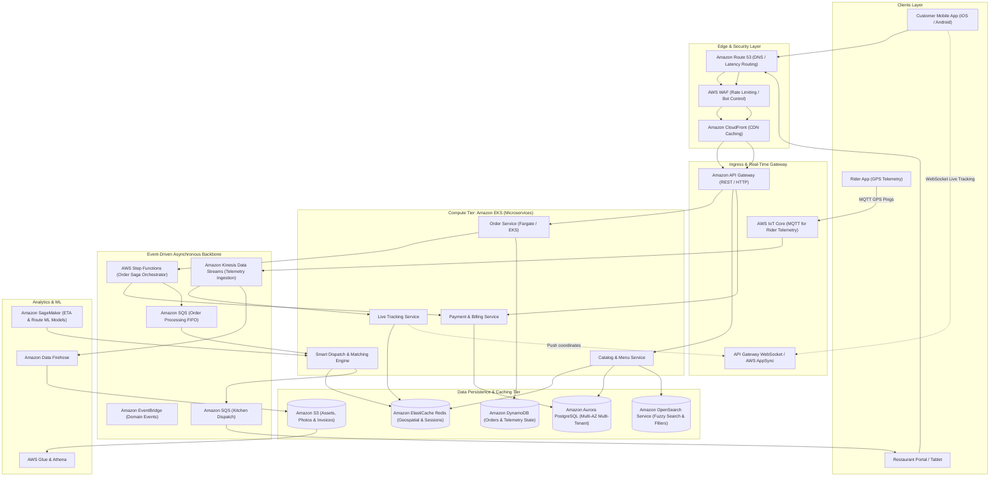
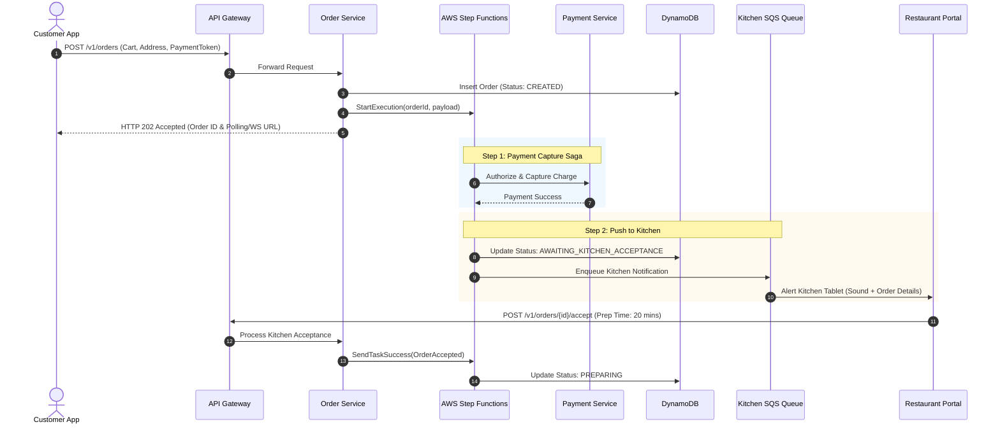
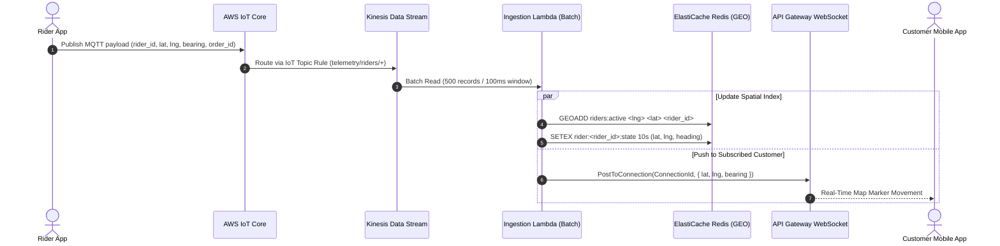
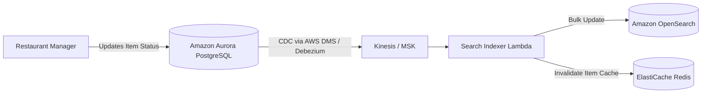

# Real-World AWS Architecture: Talabat (Food Delivery & Quick Commerce)

> **Architecture Exercise**: How to architect a hyper-local, multi-tenant food delivery and quick-commerce platform (like Talabat) capable of handling millions of orders, intense meal-time traffic spikes, real-time rider tracking, and dynamic order dispatching on AWS.

---

## Table of Contents
1. [Business & Engineering Context](#1-business--engineering-context)
2. [Key Architecture Requirements & Scale](#2-key-architecture-requirements--scale)
3. [End-to-End AWS System Architecture](#3-end-to-end-aws-system-architecture)
4. [AWS Component Breakdown & Justification](#4-aws-component-breakdown--justification)
5. [Critical Workflows & Sequence Diagrams](#5-critical-workflows--sequence-diagrams)
   - [A. Real-Time Order Placement & Kitchen Dispatch](#a-real-time-order-placement--kitchen-dispatch)
   - [B. High-Velocity Driver Location Ingestion & Live Map Tracking](#b-high-velocity-driver-location-ingestion--live-map-tracking)
   - [C. Restaurant Menu & Search Indexing Pipeline](#c-restaurant-menu--search-indexing-pipeline)
6. [Resiliency, Fault Tolerance & Flash Spikes](#6-resiliency-fault-tolerance--flash-spikes)
7. [AWS Well-Architected Framework Assessment](#7-aws-well-architected-framework-assessment)
8. [Architecture Exercise & Interview Challenges](#8-architecture-exercise--interview-challenges)

---

## 1. Business & Engineering Context

Talabat operates a **3-sided marketplace**:
1. **Consumers**: Search restaurants/groceries, customize dishes, pay, and track orders in real time.
2. **Vendors (Restaurants & Dark Stores)**: Manage menus, toggle item availability (86ing items), accept/reject orders, and track kitchen preparation times.
3. **Delivery Riders**: Receive dispatch offers based on proximity/route, transmit GPS telemetry every 3 seconds, and execute deliveries.

### Core Architectural Complexities
* **Extreme Demand Peak Spikes**: Lunch (12:00 PM – 2:30 PM) and Dinner (7:30 PM – 10:30 PM) cause 5x to 10x spikes in traffic compared to off-peak hours.
* **Low-Latency Geospatial Queries**: Matching available riders within a 3–5 km radius of a restaurant in under 100 milliseconds.
* **Bidirectional Real-Time Communication**: Push updates to customer apps (map tracking) without draining mobile battery or bombarding servers with HTTP polling.
* **Strict ACID Requirements**: Double-charging or unrecorded payments are unacceptable; order status transitions must be idempotent.

---

## 2. Key Architecture Requirements & Scale

### Target Scale Assumptions (Back-of-the-Envelope)
* **Daily Active Users (DAU)**: ~3,000,000 users.
* **Daily Orders**: ~600,000 orders/day (~7 orders/sec average, peaking at **120 orders/sec** during dinner rush).
* **Active Delivery Riders**: 35,000 concurrent riders during peak hours.
* **Telemetry Data Points**: 35,000 riders sending GPS pings every 3 seconds = **~11,600 GPS writes/sec**.
* **Restaurant Catalog**: 40,000 active restaurants, each with ~100 items.

### Non-Functional Requirements (SLAs)
| Metric | Target SLA | Architectural Enabler |
| :--- | :--- | :--- |
| **Catalog & Search Latency** | < 80ms (p99) | CloudFront edge cache + ElastiCache Redis + OpenSearch |
| **Order Placement Latency** | < 250ms (p99) | Asynchronous decoupled queuing via Amazon SQS |
| **Rider GPS Telemetry Lag** | < 1.5 seconds | AWS IoT Core / API Gateway WebSockets + ElastiCache Redis Geo |
| **Availability** | 99.99% | Multi-AZ EKS clusters + Aurora Multi-AZ + DynamoDB Global Tables |
| **Recovery Point Objective (RPO)** | 0 seconds for financial/orders | Multi-AZ synchronous replication in Aurora + DynamoDB point-in-time recovery |

---

## 3. End-to-End AWS System Architecture

---

## 4. AWS Component Breakdown & Justification

### 1. Ingress & Edge
* **Amazon CloudFront + AWS WAF**: Caches static menu photos, dishes, and restaurant banners at edge locations close to Middle East users (Dubai, Bahrain, Riyadh Edge locations). WAF blocks DDoS bots and credential stuffing attacks.
* **AWS IoT Core (MQTT)**: Delivery drivers push their GPS coordinates every 3 seconds over lightweight MQTT protocol. IoT Core maintains persistent, battery-efficient connections for 35,000+ drivers simultaneously.
* **Amazon API Gateway (WebSockets) / AWS AppSync**: Delivers real-time order state updates and moving rider markers directly to consumer devices using GraphQL Subscriptions or WebSocket frames.

### 2. Compute Tier (Amazon EKS)
* **Amazon EKS with Karpenter Autoscaling**: Runs microservices packaged as Docker containers.
* **Node Groups**: Utilizes **AWS Graviton3 (c7g/m7g)** instances for 25% better price-performance compared to x86.
* **Karpenter**: Spins up fresh EC2 worker nodes in under 45 seconds when lunch/dinner traffic surges begin, replacing slow standard Auto Scaling Groups.

### 3. Caching & Geospatial Engine
* **Amazon ElastiCache for Redis (Cluster Mode Enabled)**:
  * Uses Redis geospatial commands:
    * `GEOADD riders:locations <long> <lat> <rider_id>`
    * `GEOSEARCH riders:locations FROMLONLAT <res_long> <res_lat> BYRADIUS 3 km ASC WITHDIST WITHCOORD`
  * Sub-millisecond response times allow the dispatch engine to scan thousands of nearby riders instantly.

### 4. Data Persistence Strategy
* **Amazon Aurora PostgreSQL (Serverless v2 / Multi-AZ)**:
  * Stores relational entities: Restaurant profiles, branch configurations, menu hierarchies, promotional discounts, and financial ledgers.
  * Multi-AZ replication ensures automated failover within 30 seconds.
* **Amazon DynamoDB**:
  * Stores active order states and audit trails.
  * Partition Key: `order_id` (UUID), Sort Key: `timestamp`.
  * Single-digit millisecond latency at any throughput level with **DynamoDB Streams** triggering downstream notifications.
* **Amazon OpenSearch Service**:
  * Handles full-text search across cuisines, dish names ("shawarma", "burger", "halal"), dietary filters, and location polygon bounding.

---

## 5. Critical Workflows & Sequence Diagrams

### A. Real-Time Order Placement & Kitchen Dispatch
When a customer confirms their cart and places an order, the system executes an asynchronous **Saga Pattern** orchestrated by **AWS Step Functions**.

---

### B. High-Velocity Driver Location Ingestion & Live Map Tracking
35,000 drivers send telemetry every 3 seconds. The architecture decouples ingestion from consumer broadcasting to guarantee low server load.

---

### C. Restaurant Menu & Search Indexing Pipeline
When a restaurant manager edits a dish price or marks an item as "Out of Stock" (86'd), changes must propagate to search results within seconds.

---

## 6. Resiliency, Fault Tolerance & Flash Spikes

### 1. Flash Spikes Handling (Lunch & Dinner Rush)
* **Pre-Warming & Scheduled Autoscaling**: Scheduled scaling policies scale out EKS worker nodes and RDS read replicas 15 minutes before lunch (11:45 AM) and dinner (7:15 PM).
* **SQS Buffer Leveling**: During peak order bursts, requests hit SQS FIFO queues with deduplication IDs, ensuring microservices process orders at a controlled rate without exhausting database connection pools.

### 2. Failure Isolation
* **Circuit Breaker Pattern**: If the Payment Gateway third-party API slows down, Netflix-style circuit breakers (using Envoy or AWS App Mesh) fail fast and route to alternative backup payment gateways (e.g., Apple Pay / alternate acquirer).
* **Redis Multi-AZ with Auto-Failover**: Redis clusters operate with 1 primary and 2 read replicas spread across 3 Availability Zones. Failover takes less than 15 seconds with automated DNS update.

---

## 7. AWS Well-Architected Framework Assessment

| Pillar | Architectural Strategy in this Case |
| :--- | :--- |
| **Operational Excellence** | Infrastructure defined entirely via **AWS CDK / Terraform**. Observability through **Amazon CloudWatch Container Insights**, **AWS X-Ray** distributed traces, and Prometheus/Grafana. |
| **Security** | Zero-trust service mesh (mTLS), IAM Roles for Service Accounts (IRSA) on EKS, AWS Secrets Manager for payment API keys, AWS KMS customer-managed keys for database encryption at rest. |
| **Reliability** | Multi-AZ deployment across 3 availability zones in `me-central-1` (UAE) or `me-south-1` (Bahrain). Dead-Letter Queues (DLQ) configured on every SQS queue. |
| **Performance Efficiency** | Graviton3 processors, Redis in-memory spatial indexes, edge caching for menu assets, and decoupled streaming ingestion via Amazon Kinesis. |
| **Cost Optimization** | DynamoDB auto-scaling or on-demand mode; Spot instances for non-critical batch workers (analytics & historical aggregations); S3 Intelligent-Tiering for receipts and invoice PDFs. |

---

## 8. Architecture Exercise & Interview Challenges

### Exercise 1: The "New Year's Eve" Spike Challenge
* **Scenario**: On New Year's Eve at 8:00 PM, order volume surges to **25x normal volume**. The payment gateway latency spikes from 200ms to 4,500ms, causing worker thread pool exhaustion.
* **Design Solution**:
  1. Implement **Rate Limiting & Queue Waiting Room** at CloudFront edge using CloudFront Functions or AWS WAF.
  2. Implement **Asynchronous Payment Confirmation (Webhook / SQS)**: Instead of holding HTTP threads open while waiting for the payment gateway, immediately return HTTP 202, register a webhook callback from the payment provider, and update the order state via Step Functions when the payment confirmation arrives.

### Exercise 2: Rider Reconnection Storm
* **Scenario**: A telecom outage causes 10,000 riders in Dubai Marina to disconnect simultaneously and reconnect within a 10-second window, flooding the API with handshake requests.
* **Design Solution**:
  * AWS IoT Core handles exponential backoff with jitter on the rider mobile client.
  * Connection state is kept ephemeral in Redis, so re-establishing a connection does not trigger database writes.
