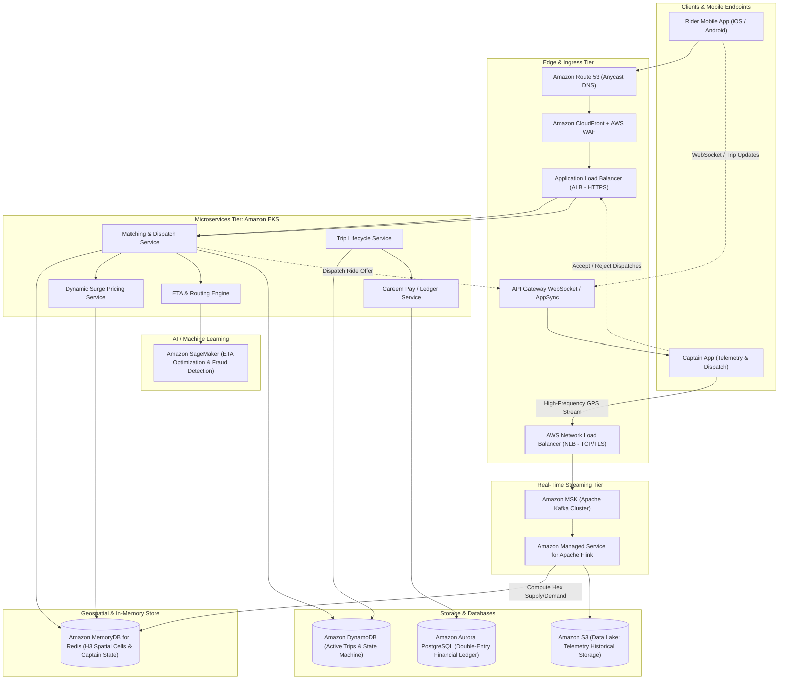
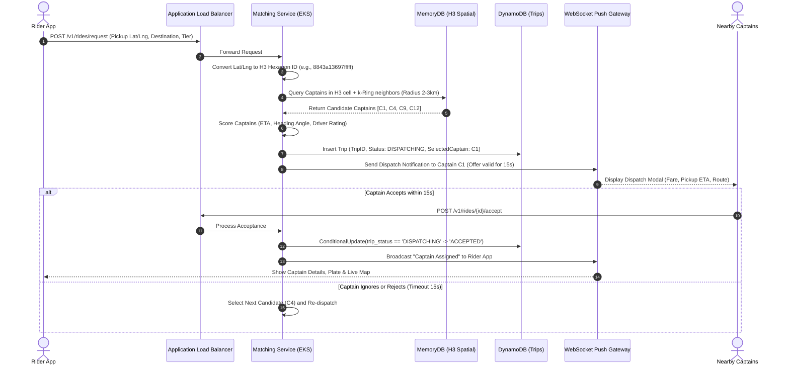
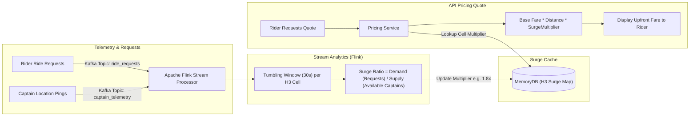
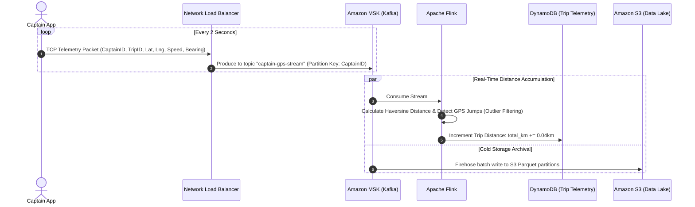

# Real-World AWS Architecture: Careem (Ride-Hailing & Super App)

[](https://aws.amazon.com/architecture/well-architected/)
[]()
[]()

> **Architecture Exercise**: How to build a high-concurrency, low-latency mobility and ride-hailing architecture on AWS (like Careem / Uber) that handles sub-second driver-rider matching, Uber H3 geospatial hexagon indexing, real-time dynamic surge pricing, and high-frequency GPS telemetry streaming.

---

## Table of Contents
1. [Business & Engineering Context](#1-business--engineering-context)
2. [Target Scale & Engineering Constraints](#2-target-scale--engineering-constraints)
3. [End-to-End AWS System Architecture](#3-end-to-end-aws-system-architecture)
4. [AWS Service Selection & Architectural Trade-Offs](#4-aws-service-selection--architectural-trade-offs)
5. [Core Deep-Dive Workflows & Sequence Diagrams](#5-core-deep-dive-workflows--sequence-diagrams)
   - [A. Ride Request & Captain Matching Engine (H3 Geospatial Index)](#a-ride-request--captain-matching-engine-h3-geospatial-index)
   - [B. Real-Time Dynamic Surge Pricing Engine](#b-real-time-dynamic-surge-pricing-engine)
   - [C. High-Frequency Captain Telemetry & Trip Fare Calculation](#c-high-frequency-captain-telemetry--trip-fare-calculation)
6. [Super App Financial Ledger & Careem Pay](#6-super-app-financial-ledger--careem-pay)
7. [AWS Well-Architected Framework Assessment](#7-aws-well-architected-framework-assessment)
8. [Architecture Challenges & Practice Interview Questions](#8-architecture-challenges--practice-interview-questions)

---

## 1. Business & Engineering Context

Careem serves tens of millions of users across the Middle East, North Africa, and South Asia. The mobility engine coordinates two primary actors:
* **The Rider**: Requests rides with specific vehicle tiers (Economy, Business, Max, Halataxi), expects instant fare quotes, precise pick-up ETAs, and continuous car movement on the map.
* **The Captain (Driver)**: Broadcasts GPS telemetry continuously, receives ride dispatches via a broadcast auction model, and navigates optimized pickup and drop-off routes.

### Primary Engineering Challenges
1. **Sub-Second Matching**: When a user taps "Yalla", matching must evaluate dozens of nearby captains, score them based on ETA, ratings, and heading direction, and dispatch the offer in **under 800ms**.
2. **Surge Pricing Imbalance Detection**: Detecting localized supply-demand deficits in real-time using hexagonal spatial cells (Uber H3 Index at resolution 7–9).
3. **Telemetry Flood**: Hundreds of thousands of captains streaming GPS coordinates every 2 to 4 seconds, requiring high-throughput, low-cost ingestion without dropping packets.
4. **Idempotent Ride State Transitions**: Preventing race conditions where two captains accept the same ride simultaneously, or a cancelled ride triggers a dispatch.

---

## 2. Target Scale & Engineering Constraints

### Scale Metrics (Back-of-the-Envelope)
* **Daily Completed Rides**: 1,500,000 rides.
* **Concurrent Active Captains**: 100,000 captains during peak rush hours.
* **Telemetry Volume**: 100,000 captains × 0.5 pings/sec (every 2s) = **50,000 GPS pings/sec**.
* **Payload per Ping**: ~250 bytes $\rightarrow$ **~12.5 MB/sec continuous ingestion bandwidth**.
* **Matching Requests**: ~2,000 ride requests/minute peak (~33 requests/sec).

### Non-Functional Requirements (SLAs)
| Requirement | Target SLA | Architectural Enabler |
| :--- | :--- | :--- |
| **Matching Latency** | < 800ms (p95) | In-memory H3 spatial indexing in Amazon MemoryDB / Redis |
| **Telemetry Ingestion Lag** | < 1 second | Amazon Managed Streaming for Apache Kafka (Amazon MSK) |
| **Surge Price Re-computation** | Every 30 seconds | Amazon Managed Service for Apache Flink (real-time stream analytics) |
| **Ride State Consistency** | Strict Serializability | Amazon DynamoDB TransactWriteItems or Aurora ACID transactions |
| **System Uptime** | 99.999% | Multi-Region Active-Active routing for critical booking paths |

---

## 3. End-to-End AWS System Architecture



---

## 4. AWS Service Selection & Architectural Trade-Offs

| Capability | Chosen AWS Service | Justification & Comparison |
| :--- | :--- | :--- |
| **High-Throughput Telemetry** | **Amazon MSK (Kafka)** | Ingesting 50k writes/sec with high partition concurrency. Kinesis could work, but MSK allows native integration with Flink and custom Kafka partition keys (e.g., `h3_index_res7`). |
| **Real-Time Stream Processing** | **Amazon Managed Service for Apache Flink** | Windowed calculations (e.g., 60-second sliding windows of rider requests vs captain count per H3 cell) with zero server management and stateful tumbling windows. |
| **Geospatial & Session State** | **Amazon MemoryDB for Redis** | Redis data structures with Multi-AZ transaction log durability. Unlike standard ElastiCache Redis, MemoryDB guarantees **zero data loss** upon node failure. |
| **Trip Lifecycle Management** | **Amazon DynamoDB** | Single-digit millisecond latency with atomic updates using condition expressions (`attribute_exists(ride_id) AND trip_status = 'SEARCHING'`). |
| **Financial Ledger / Careem Pay** | **Amazon Aurora PostgreSQL (Multi-AZ)** | Strict ACID compliance for double-entry bookkeeping, foreign key constraints, and financial audits. |

---

## 5. Core Deep-Dive Workflows & Sequence Diagrams

### A. Ride Request & Captain Matching Engine (H3 Geospatial Index)

The city is partitioned into **Uber H3 hexagonal grid cells**.
* Resolution 8: Hexagon area of ~0.73 km² (edge length ~460m).
* Captains continuously update their current H3 cell.
* When a rider requests a car, the search expands in concentric hexagonal rings ($k$-ring 0, 1, 2) around the pickup point.



---

### B. Real-Time Dynamic Surge Pricing Engine

Surge pricing balances marketplace liquidity. If 500 riders request rides around Dubai Mall after a fireworks show, but only 50 captains are available in cell `8843a136...`, the multiplier increases automatically.



---

### C. High-Frequency Captain Telemetry & Trip Fare Calculation

Captains stream GPS points. Instead of writing each point directly to disk, the stream accumulates distance and calculates the final fare based on actual route telemetry.



---

## 6. Super App Financial Ledger & Careem Pay

Careem Pay requires zero tolerance for financial discrepancies.
* **Double-Entry Bookkeeping**: Every transaction consists of balanced debits and credits:
  * Debit: `Customer_Wallet` (-$15.00)
  * Credit: `Captain_Payable` (+$12.00)
  * Credit: `Careem_Take_Rate_Revenue` (+$3.00)
* Implemented on **Amazon Aurora PostgreSQL** with serializable transaction isolation level.

```sql
-- Conceptual Careem Pay Double-Entry Ledger Transaction
BEGIN;
  INSERT INTO journal_entries (id, trip_id, currency, created_at) 
  VALUES ('j_98231', 'trip_4412', 'AED', NOW());

  INSERT INTO ledger_postings (entry_id, account_id, amount, direction)
  VALUES 
    ('j_98231', 'customer_wallet_user123', -50.00, 'DEBIT'),
    ('j_98231', 'captain_earnings_cap99', 40.00, 'CREDIT'),
    ('j_98231', 'platform_commission', 10.00, 'CREDIT');
COMMIT;
```

---

## 7. AWS Well-Architected Framework Assessment

| Pillar | Implementation in Careem Mobility Architecture |
| :--- | :--- |
| **Operational Excellence** | Blue/Green deployments for EKS services with **ArgoCD**. Synthetic canary trips simulating ride bookings every minute across key cities to alert before users notice failures. |
| **Security** | TLS 1.3 enforced at NLB/ALB. Captain phone numbers and rider identities masked using AWS Lambda integrations with Twilio/telecom proxies (No direct PII exposure). |
| **Reliability** | Active-Active Multi-AZ. In case of an AWS Availability Zone degradation, Kubernetes cluster autoscaler sheds non-critical workloads (recommendation engine) to prioritize matching and active rides. |
| **Performance Efficiency** | Uber H3 spatial math evaluated in memory; Apache Flink sub-second windowed calculations; Kafka topic partitioning by geospatial quadrant. |
| **Cost Optimization** | High-volume GPS coordinates batched into Parquet files before long-term S3 storage; Amazon S3 Glacier Flexible Deep Archive for trip receipts older than 90 days. |

---

## 8. Architecture Challenges & Practice Interview Questions

### Challenge 1: The "Dual-Acceptance" Race Condition
* **Problem**: Two captains accept the same ride offer at the exact same millisecond due to network race conditions.
* **Solution**:
  * Use **DynamoDB Conditional Writes**:
    ```python
    dynamodb.update_item(
        TableName='Trips',
        Key={'trip_id': {'S': trip_id}},
        UpdateExpression='SET captain_id = :cid, trip_status = :accepted',
        ConditionExpression='trip_status = :dispatching',
        ExpressionAttributeValues={
            ':cid': {'S': captain_id},
            ':accepted': {'S': 'ACCEPTED'},
            ':dispatching': {'S': 'DISPATCHING'}
        }
    )
    ```
  * Only one captain's write succeeds; the second receives a `ConditionalCheckFailedException` and the mobile app is notified immediately that the ride was already taken.

### Challenge 2: Telemetry GPS Spoofing & Fraud Detection
* **Problem**: Dishonest captains use GPS mocking apps to simulate ride distance and inflate fares.
* **Solution**:
  * Telemetry pings processed in **Apache Flink** validate unrealistic speed or teleportation (e.g., speed > 180 km/h or impossible distance jumps within 2 seconds).
  * Suspicious trips are flagged to an asynchronous **Amazon SageMaker** fraud scoring model, placing the trip fare on hold for automated review.
