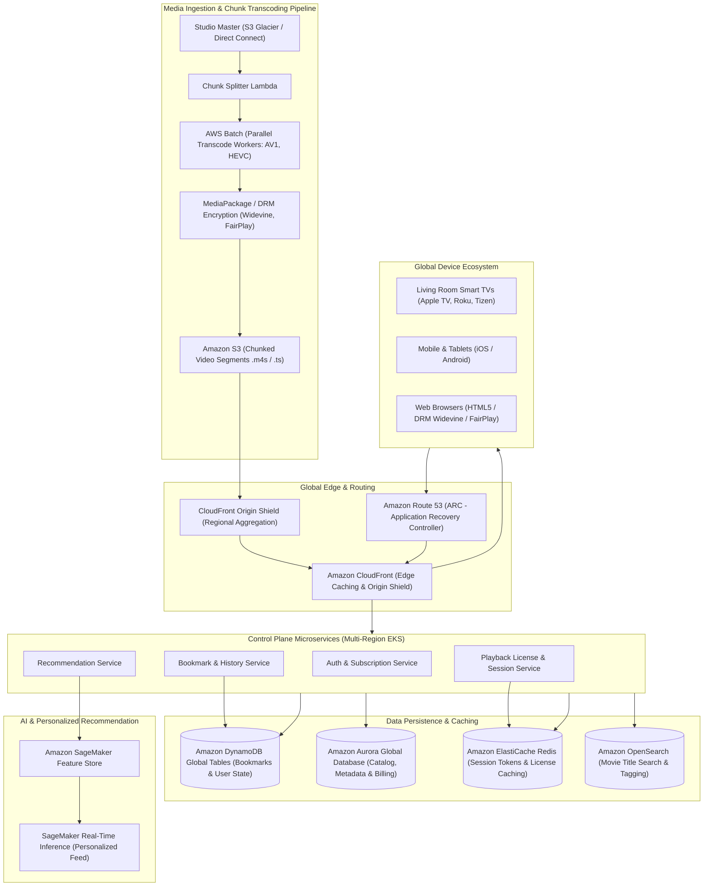
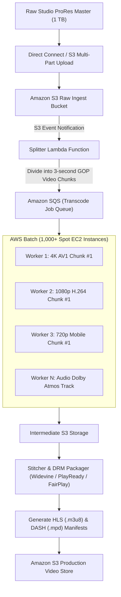
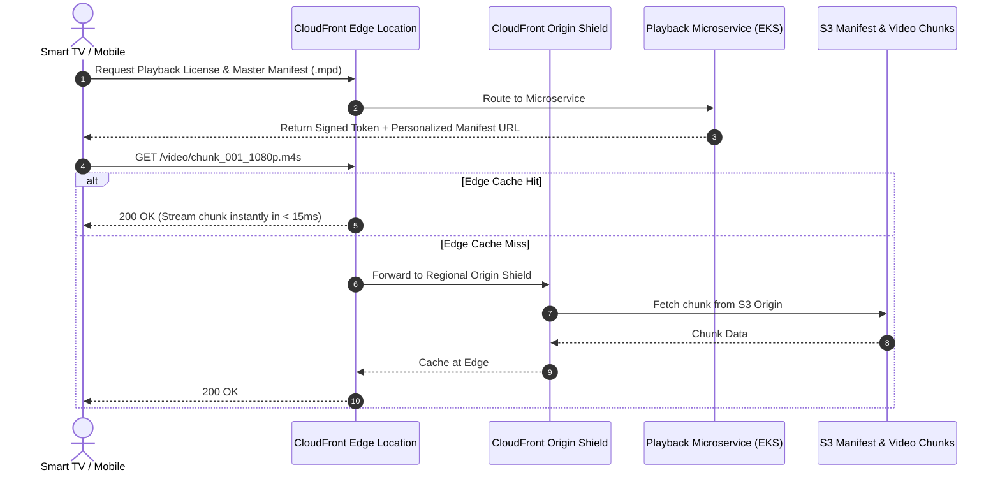
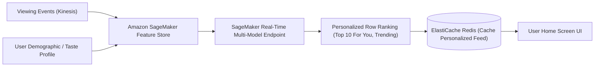

# Real-World AWS Architecture: Netflix (Global Video Streaming & VOD Platform)

[](https://aws.amazon.com/architecture/well-architected/)
[]()
[]()

> **Architecture Exercise**: How to architect a planetary-scale video-on-demand (VOD) streaming infrastructure on AWS (like Netflix) supporting 250M+ global subscribers, distributed video transcoding pipelines, multi-region active-active disaster recovery, personalized recommendation engines, and bookmark sync.

---

## Table of Contents
1. [Business & Engineering Context](#1-business--engineering-context)
2. [Target Scale & Planetary Constraints](#2-target-scale--planetary-constraints)
3. [End-to-End AWS System Architecture](#3-end-to-end-aws-system-architecture)
4. [The Video Ingestion & Transcoding Pipeline](#4-the-video-ingestion--transcoding-pipeline)
5. [Global Edge Delivery & Content Distribution (CloudFront & Open Connect)](#5-global-edge-delivery--content-distribution-cloudfront--open-connect)
6. [Multi-Region Active-Active Disaster Recovery Architecture](#6-multi-region-active-active-disaster-recovery-architecture)
7. [User Playback State & Bookmark Sync (DynamoDB Global Tables)](#7-user-playback-state--bookmark-sync-dynamodb-global-tables)
8. [Personalized Recommendation Engine (SageMaker & Feature Store)](#8-personalized-recommendation-engine-sagemaker--feature-store)
9. [AWS Well-Architected Framework Assessment](#9-aws-well-architected-framework-assessment)
10. [Architecture Challenges & Practice Interview Questions](#10-architecture-challenges--practice-interview-questions)

---

## 1. Business & Engineering Context

Netflix operates one of the world's most sophisticated cloud architectures, running almost entirely on AWS for control-plane microservices, user profiles, recommendation algorithms, and transcoding, paired with Open Connect and CloudFront for edge media delivery.

### Key Functional Systems
1. **Master Video Ingestion & Packaging**: Transforming multi-terabyte raw movie ProRes masters into thousands of chunked video/audio streams encoded for diverse bitrates, codecs (AV1, HEVC, H.264), resolutions (SD, HD, 4K HDR), and languages.
2. **Playback Session & Bookmark Tracking**: Persisting second-by-second playback progress for hundreds of millions of concurrent streams so users can switch seamlessly from living room Smart TV to mobile.
3. **Recommendation Engine**: Generating tailored home screens and thumbnail artworks tailored to individual viewing history.
4. **Resiliency to Cloud Disasters**: Surviving complete AWS Region outages with automated traffic evacuation in **under 7 minutes**.

---

## 2. Target Scale & Planetary Constraints

### Scale Metrics (Back-of-the-Envelope)
* **Global Subscribers**: ~260,000,000 paying members.
* **Concurrent Streaming Sessions (Peak Hours)**: 30,000,000 simultaneous streams.
* **Video Catalog Size**: Thousands of titles, each resulting in **~1,200 output encoding profiles** (video resolutions, audio tracks, subtitles).
* **Bookmark Sync Writes**: 30,000,000 active streams syncing playback timestamp every 10 seconds = **3,000,000 writes/sec** to state storage.
* **Global Outbound Video Bandwidth**: Exceeds **50–80 Terabits per second (Tbps)** globally during peak hours.

### Non-Functional Requirements (SLAs)
| Metric | Target SLA | Architectural Enabler |
| :--- | :--- | :--- |
| **Time-to-First-Frame (TTFF)** | < 1.2 seconds | Edge byte-range caching, CloudFront Origin Shield, HTTP/3 |
| **Catalog API Availability** | 99.999% ("Five Nines") | Multi-Region Active-Active deployment with Route 53 Application Recovery Controller |
| **Bookmark Sync Latency** | < 2 seconds globally | Amazon DynamoDB Global Tables (multi-master replication) |
| **Transcoding Turnaround** | < 45 mins for a 2-hour movie | Massively parallel chunked transcoding using AWS Batch + AWS Lambda |

---

## 3. End-to-End AWS System Architecture



---

## 4. The Video Ingestion & Transcoding Pipeline

Encoding a 4K movie sequentially on a single server takes hours. Netflix uses a **massively parallel chunk-based split-and-stitch architecture**.



1. **Splitting**: When a master video lands in S3, a Lambda splits the video into 3-second GOP (Group of Pictures) boundaries.
2. **Parallel Transcoding**: AWS Batch spins up thousands of Spot instances with GPU acceleration to encode chunks into hundreds of profile variations simultaneously.
3. **Packaging & DRM**: Chunks are assembled, encrypted with DRM keys, and packaged into HLS (Apple) and MPEG-DASH (Android/Web/Smart TVs) manifests.

---

## 5. Global Edge Delivery & Content Distribution

While Netflix operates its proprietary Open Connect hardware appliances inside ISP networks, **Amazon CloudFront** serves as the dynamic API acceleration layer, manifest distributor, and global edge cache.



---

## 6. Multi-Region Active-Active Disaster Recovery Architecture

If an entire AWS Region (e.g., `us-east-1`) suffers a catastrophic power outage or fiber cut, Netflix traffic must shift to `us-west-2` or `eu-west-1` with zero user disruption.

```mermaid
flowchart LR
    User["Global Viewer"] --> R53ARC["Amazon Route 53 ARC (Routing Control)"]

    subgraph RegionA["AWS Region: us-east-1 (Primary)"]
        ALB1["Application Load Balancer"]
        EKS1["EKS Microservices Cluster"]
        Dynamo1[("DynamoDB (Global Table - US East)")]
        Aurora1[("Aurora Global DB (Writer)")]
    end

    subgraph RegionB["AWS Region: us-west-2 (Secondary Active)"]
        ALB2["Application Load Balancer"]
        EKS2["EKS Microservices Cluster"]
        Dynamo2[("DynamoDB (Global Table - US West)")]
        Aurora2[("Aurora Global DB (Read Replica / Fast Promotion)")]
    end

    R53ARC -->|100% Traffic Normal| ALB1
    R53ARC -.->|Evacuation Failover in < 7 mins| ALB2

    ALB1 --> EKS1 --> Dynamo1
    EKS1 --> Aurora1

    ALB2 --> EKS2 --> Dynamo2
    EKS2 --> Aurora2

    Dynamo1 <-->|Bi-Directional Multi-Master Sync (<1s)| Dynamo2
    Aurora1 -->|Storage-Level Cross-Region Replication (<1s)| Aurora2
```

* **Route 53 Application Recovery Controller (ARC)**: Provides atomic routing switches that redirect DNS queries within minutes without relying on slow DNS TTL decay.
* **Bi-Directional State Replication**: Both regions can accept writes to DynamoDB simultaneously using DynamoDB Global Tables (last-writer-wins resolution).

---

## 7. User Playback State & Bookmark Sync (DynamoDB Global Tables)

When a viewer pauses a movie, their timestamp (`time_offset_seconds: 3412`) must replicate globally so they can continue seamlessly on another device.

### DynamoDB Table Schema
* **Table Name**: `PlaybackBookmarks`
* **Partition Key (`PK`)**: `USER#<user_id>` (e.g., `USER#9834101`)
* **Sort Key (`SK`)**: `PROFILE#<profile_id>#MOVIE#<movie_id>`
* **Attributes**: `playback_position_sec`, `total_duration_sec`, `last_updated_at`, `audio_track`, `subtitle_lang`.

```json
{
  "PK": "USER#u98214",
  "SK": "PROFILE#dad#MOVIE#m7712",
  "playback_position_sec": 4218,
  "total_duration_sec": 7200,
  "completed_ratio": 0.58,
  "updated_at": "2026-09-30T14:22:00Z"
}
```

* **Write Buffering**: Instead of spamming the database every second, client devices buffer timestamps and emit a sync beacon every **10 seconds** or upon explicit pause/stop events.

---

## 8. Personalized Recommendation Engine (SageMaker & Feature Store)



---

## 9. AWS Well-Architected Framework Assessment

| Pillar | Architectural Strategy in this Case |
| :--- | :--- |
| **Operational Excellence** | **Chaos Monkey / AWS Fault Injection Service (FIS)** randomly terminates EC2 nodes, injects network latency, and simulates AZ outages during business hours to prove architecture self-heals. |
| **Security** | DRM token licensing, AWS Key Management Service (KMS) for envelope encryption of content keys, strict token expiration on CloudFront Signed URLs and Signed Cookies. |
| **Reliability** | Active-Active Multi-Region routing, automated circuit breaking (Hystrix / Resilience4j pattern), zero single point of failure. |
| **Performance Efficiency** | CloudFront Origin Shield eliminates redundant origin fetches by up to 85%; chunked media streaming reduces buffering to under 1% of total viewing time. |
| **Cost Optimization** | **AWS Spot Instances** utilized for 90% of video transcoding compute workloads, saving up to 70% compared to On-Demand EC2 pricing. |

---

## 10. Architecture Challenges & Practice Interview Questions

### Challenge 1: The "Squid Game Season Launch" Herd Problem
* **Scenario**: A hit show drops worldwide at 12:00 AM PST. 20 million users open the app simultaneously, causing a cache stampede on the show's metadata and first episode chunks.
* **Solution**:
  1. **Pre-Warming & Edge Pinning**: CloudFront caches and Origin Shield are pre-warmed with the first 3 chunks (9 seconds) of Episode 1 across all global edge locations before release time.
  2. **Collapse Forwarding (`origin-request-collapse`)**: CloudFront merges identical incoming requests for the same video segment so only 1 request goes to the S3 origin while others wait and share the cached response.

### Challenge 2: Handling Network Degradation on Mobile Devices
* **Scenario**: A user goes through a subway tunnel and connection speed drops from 50 Mbps to 400 Kbps.
* **Solution**:
  * The media player utilizes **Adaptive Bitrate Streaming (ABR)**. When the buffer size drops below 5 seconds, the client player automatically requests the next 3-second chunk from a lower bitrate profile (e.g., switches from 1080p to 360p) without stalling video playback.
