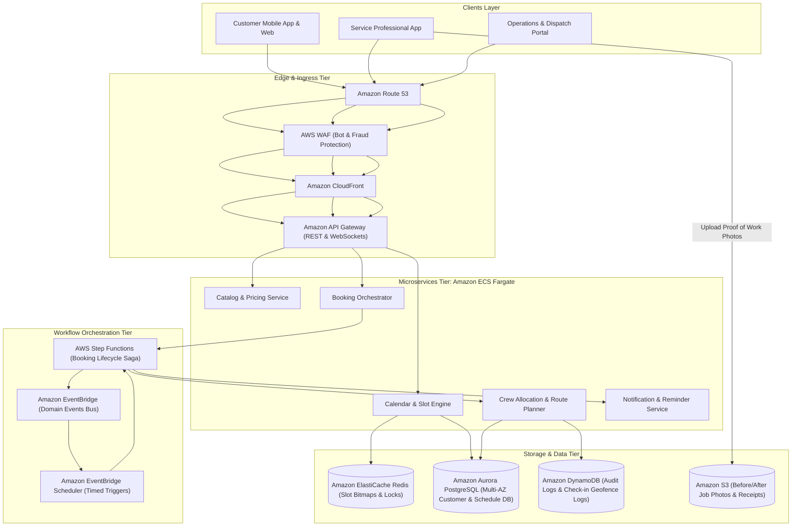
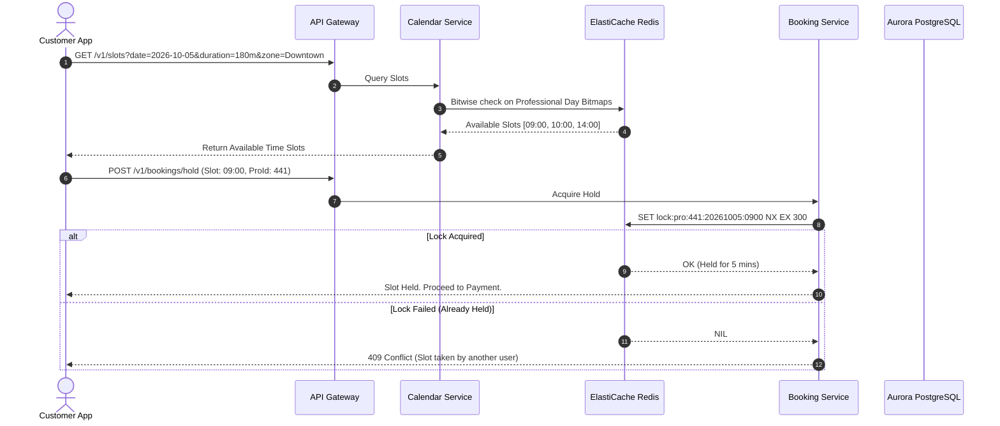
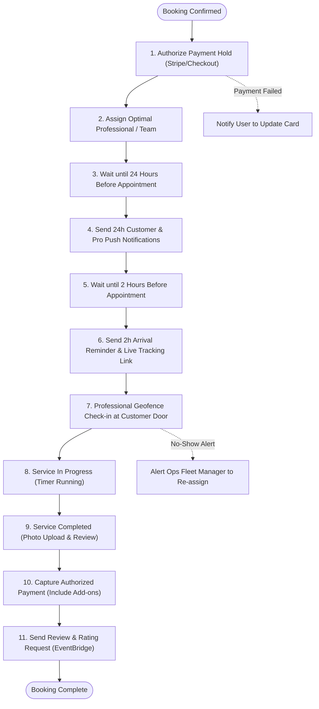
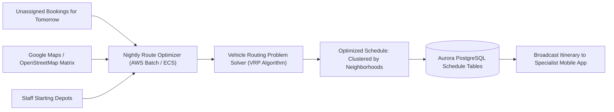

# Real-World AWS Architecture: Justlife (On-Demand Home Services Marketplace)

> **Architecture Exercise**: How to architect an on-demand home services marketplace on AWS (like Justlife) supporting complex recurring calendar scheduling, crew route optimization, multi-day booking lifecycles, and resilient asynchronous notifications using AWS Step Functions and EventBridge.

---

## Table of Contents
1. [Business & Engineering Context](#1-business--engineering-context)
2. [Target Scale & Engineering Constraints](#2-target-scale--engineering-constraints)
3. [End-to-End AWS System Architecture](#3-end-to-end-aws-system-architecture)
4. [AWS Service Selection & Architectural Rationale](#4-aws-service-selection--architectural-rationale)
5. [Core Deep-Dive Workflows & Sequence Diagrams](#5-core-deep-dive-workflows--sequence-diagrams)
   - [A. High-Concurrency Calendar Slot Availability & Double-Booking Prevention](#a-high-concurrency-calendar-slot-availability--double-booking-prevention)
   - [B. Multi-Day Booking Lifecycle State Machine (AWS Step Functions)](#b-multi-day-booking-lifecycle-state-machine-aws-step-functions)
   - [C. Service Crew Route Optimization & Dispatch](#c-service-crew-route-optimization--dispatch)
6. [Recurring Subscription Engine (Weekly / Bi-Weekly Services)](#6-recurring-subscription-engine-weekly--bi-weekly-services)
7. [AWS Well-Architected Framework Assessment](#7-aws-well-architected-framework-assessment)
8. [Architecture Challenges & Practice Interview Questions](#8-architecture-challenges--practice-interview-questions)

---

## 1. Business & Engineering Context

Justlife (formerly Justmop) is the leading on-demand home services platform in the Middle East, offering home cleaning, beauty & wellness at home, PCR/healthcare tests, AC maintenance, and pest control.

### Three Primary Stakeholders
1. **The Customer**: Selects home size, preferred cleaning supplies, date/time slot, preferred maid/crew, or books recurring weekly visits.
2. **The Service Professional (Crew / Specialist)**: Receives schedules, checks in/out via GPS geofencing at customer residences, and logs job completion.
3. **The Operations & Logistics Team**: Manages company-owned vs third-party agency fleets, driver transportation vans, and shift allocations.

### Architectural Complexities Compared to Food/Rides
* **Long Booking Lifecycle**: Unlike an order that completes in 30 minutes, a home service booking is scheduled days or weeks in advance, can be rescheduled, recurring, or cancelled.
* **Complex Slot Availability**: A 3-hour cleaning requires checking not just instantaneous availability, but a continuous contiguous time window + buffer travel time between client locations.
* **Double-Booking Prevention**: High concurrency when thousands of users browse the same Friday morning 9:00 AM slots.

---

## 2. Target Scale & Engineering Constraints

### Scale Assumptions
* **Active Customers**: ~1,200,000 registered users.
* **Bookings Completed Daily**: ~25,000 service jobs/day.
* **Service Professionals**: ~8,000 active cleaners, beauticians, and technicians.
* **Slot Queries**: ~1,500 slot availability requests/sec during peak booking times (Thursday evening and Sunday morning).

### Non-Functional Requirements (SLAs)
| Requirement | Target SLA | Architectural Enabler |
| :--- | :--- | :--- |
| **Slot Search Latency** | < 120ms (p95) | In-memory bitmap slot representation in Amazon ElastiCache Redis |
| **Booking State Reliability** | Zero missed appointments | AWS Step Functions with durable wait states and execution history |
| **Concurrency Protection** | 100% double-booking prevention | Distributed Redis locks (Redlock) + PostgreSQL serializable isolation |
| **Notification Reliability** | 99.99% delivery | Amazon EventBridge + Amazon Pinpoint / SNS |

---

## 3. End-to-End AWS System Architecture

---

## 4. AWS Service Selection & Architectural Rationale

| Capability | AWS Service Chosen | Why This Service? |
| :--- | :--- | :--- |
| **Stateful Workflow Orchestration** | **AWS Step Functions** | Cleanly models multi-day state machines with native `Wait` states (e.g. wait until 2 hours before job), error catchers, and compensation rollbacks. |
| **Time-Based Scheduling** | **Amazon EventBridge Scheduler** | Supports millions of precise scheduled one-off tasks (e.g., "Fire reminder at 2026-10-02 07:00 AM UTC") without polling databases. |
| **High-Performance Slot Availability** | **Amazon ElastiCache for Redis** | Stores professional schedules as **Bitmaps** (each bit = 15-minute slot). Checking a 3-hour opening is a fast bitwise operation (`BITPOS` / `BITFIELD`). |
| **Relational Core Data** | **Amazon Aurora PostgreSQL Serverless v2** | Handles multi-table relational queries (customer addresses, service types, contractor agencies, weekly recurrence rules). |
| **Job Media & Photo Storage** | **Amazon S3 + Presigned URLs** | Cleaners upload before/after photos directly to S3 via pre-signed URLs without passing multi-MB payloads through API servers. |

---

## 5. Core Deep-Dive Workflows & Sequence Diagrams

### A. High-Concurrency Calendar Slot Availability & Double-Booking Prevention

To prevent two users from booking the same professional at the same time:
1. Availability is checked via **Redis Bitmaps**.
2. A **distributed lock** is acquired for 5 minutes during checkout.
3. The booking is finalized in **Aurora PostgreSQL** with an exclusion constraint.

---

### B. Multi-Day Booking Lifecycle State Machine (AWS Step Functions)

Home service bookings span days. AWS Step Functions orchestrates the entire journey from payment authorization to completion:

---

### C. Service Crew Route Optimization & Dispatch

Rather than assigning professionals individually, teams and transportation vans are routed efficiently to minimize driving time across city zones:

---

## 6. Recurring Subscription Engine (Weekly / Bi-Weekly Services)

Over 60% of Justlife bookings are recurring (e.g., every Monday & Wednesday at 10:00 AM).
* **Amazon EventBridge Scheduler** is configured with recurrent cron rules for each subscription ID.
* 48 hours before each scheduled occurrence, the cron event triggers a Lambda function that:
  1. Creates the specific booking instance in Aurora PostgreSQL.
  2. Pre-reserves the user's favorite cleaner.
  3. Pre-authorizes the card on file.
  4. Starts the booking Step Functions state machine.

---

## 7. AWS Well-Architected Framework Assessment

| Pillar | Strategy in Justlife Home Services Architecture |
| :--- | :--- |
| **Operational Excellence** | Automated end-to-end tracing with **AWS X-Ray** across API Gateway $\rightarrow$ ECS $\rightarrow$ Step Functions $\rightarrow$ Aurora, enabling ops to diagnose any delayed appointment alert in seconds. |
| **Security** | Sensitive customer addresses, door codes, and phone numbers are encrypted with **AWS KMS** and decrypted only on-demand inside isolated microservices. |
| **Reliability** | Long-running asynchronous workflows executed on **AWS Step Functions**, which store state durably and survive any compute server crash without losing job context. |
| **Performance Efficiency** | Slot availability pre-calculated into fast Redis bitmaps; S3 Pre-signed URLs for high-resolution photo uploads offload heavy I/O from backend APIs. |
| **Cost Optimization** | Workloads run on **Amazon ECS Fargate** with auto-scaling to zero during late-night hours when booking activity is minimal. |

---

## 8. Architecture Challenges & Practice Interview Questions

### Challenge 1: The "Same Maid Preference" Constraint
* **Problem**: Customers frequently request the exact same cleaner for recurring weekly slots. If that cleaner takes annual leave or is sick, how should the architecture reassign without disappointing the customer?
* **Solution**:
  1. The cleaner's leave calendar is updated in Aurora PostgreSQL, which emits a `CLEANER_UNAVAILABLE` event to EventBridge.
  2. EventBridge triggers a Re-assignment Lambda that finds candidate cleaners matching:
     - Same gender / language preference.
     - Rating $\ge 4.85$.
     - Proximity to customer zone.
  3. The system sends an automated SMS/Push to the customer: *"Fatima is on leave; we've assigned top-rated Maria. Tap to accept or reschedule for free."*

### Challenge 2: Handling Service Over-Runs (Extra Hours)
* **Problem**: The customer asks the cleaner to stay for 1 additional hour to clean the balcony. How is this captured and billed securely?
* **Solution**:
  * The specialist taps "Request +1 Hour" on their app.
  * The customer mobile app receives an immediate push authorization prompt.
  * Upon customer approval, an API Gateway call signals the active Step Functions execution via `SendTaskSuccess`, adjusting the booking duration and updating the payment capture hold amount before checkout.
