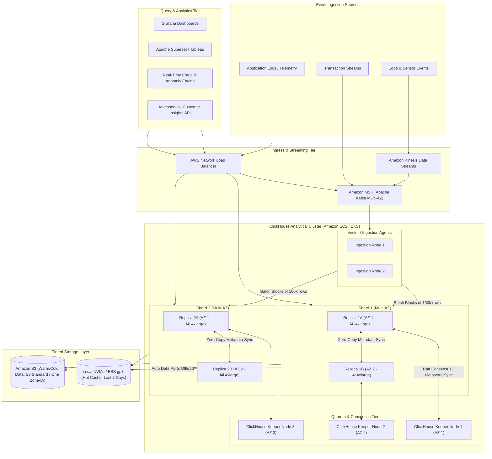
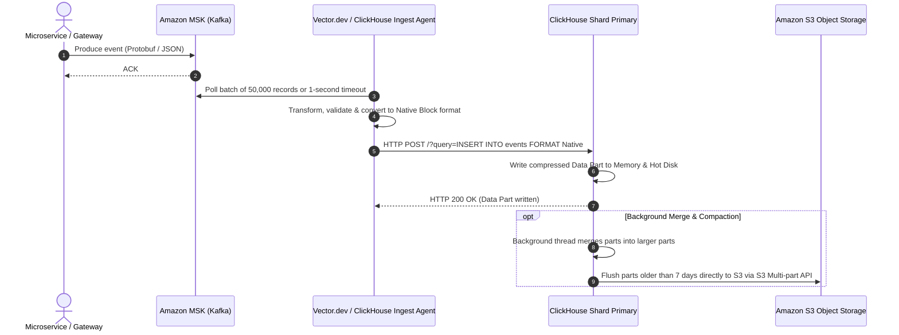

# Real-World AWS Architecture: ClickHouse (Real-Time Columnar OLAP Platform)

[](https://aws.amazon.com/architecture/well-architected/)
[]()
[]()

> **Architecture Exercise**: How to architect an enterprise-grade, real-time analytical data platform on AWS using **ClickHouse** with tiered storage (NVMe EBS + Amazon S3), zero-copy replication via ClickHouse Keeper, high-throughput event streaming via Amazon MSK (Kafka), and sub-second analytical queries across billions of rows.

---

## Table of Contents
1. [Business & Engineering Context](#1-business--engineering-context)
2. [Target Scale & Engineering Constraints](#2-target-scale--engineering-constraints)
3. [End-to-End AWS System Architecture](#3-end-to-end-aws-system-architecture)
4. [Storage Tiering: NVMe Local Cache + Amazon S3 Object Storage](#4-storage-tiering-nvme-local-cache--amazon-s3-object-storage)
5. [High-Throughput Streaming Ingestion Pipeline](#5-high-throughput-streaming-ingestion-pipeline)
6. [ClickHouse Keeper & Zero-Copy Replication on AWS](#6-clickhouse-keeper--zero-copy-replication-on-aws)
7. [AWS Well-Architected Framework Assessment](#7-aws-well-architected-framework-assessment)
8. [Architecture Challenges & Practice Interview Questions](#8-architecture-challenges--practice-interview-questions)

---

## 1. Business & Engineering Context

Modern digital businesses (fintechs, ad-tech, observability platforms, e-commerce) require real-time SQL analytics over massive streams of events (logs, clickstreams, financial transactions, telemetry). Traditional transactional databases (PostgreSQL/MySQL) crumble under aggregate queries over hundreds of millions of rows, and data warehouses (Redshift/Snowflake) often have minutes of ingestion latency.

**ClickHouse** is an open-source, column-oriented DBMS designed for online analytical processing (OLAP). Architecting ClickHouse on AWS enables:
* Real-time stream ingestion with sub-second query latency (`GROUP BY`, `COUNT DISTINCT` over billions of records).
* Disaggregated storage and compute utilizing **Amazon S3** as an infinite columnar storage tier with local NVMe caching.
* High availability across AWS Availability Zones without data loss.

---

## 2. Target Scale & Engineering Constraints

### Scale Metrics (Back-of-the-Envelope)
* **Ingestion Throughput**: 500,000 events/sec sustained, peaking at **1,500,000 events/sec**.
* **Daily Ingested Volume**: ~10 TB of raw uncompressed JSON/Protobuf $\rightarrow$ ~1.2 TB compressed in ClickHouse columnar format (~8-10x compression).
* **Total Historical Data**: 1.5 Petabytes stored cost-effectively in Amazon S3.
* **Concurrent Analytical Queries**: 250 queries/sec (dashboards, ad-hoc analyst queries, automated alerting).

### Non-Functional Requirements (SLAs)
| Metric | Target SLA | Architectural Enabler |
| :--- | :--- | :--- |
| **P95 Query Latency** | < 250ms for 24h queries | Vectorized query engine + Local NVMe SSD cache tier |
| **Ingestion Freshness** | < 2 seconds from event emission | Amazon MSK + ClickHouse native streaming consumer buffer |
| **Storage Cost Efficiency** | < $0.03 / GB / month | Automated lifecycle migration to Amazon S3 Standard & S3 One Zone-IA |
| **Cluster Availability** | 99.99% | Multi-AZ ClickHouse Keeper quorum + Zero-Copy Replication on S3 |

---

## 3. End-to-End AWS System Architecture



---

## 4. Storage Tiering: NVMe Local Cache + Amazon S3 Object Storage

To balance query performance and cost at petabyte scale, ClickHouse uses a **hybrid multi-volume storage policy** on AWS:

```xml
<!-- ClickHouse storage_configuration.xml snippet -->
<clickhouse>
    <storage_configuration>
        <disks>
            <!-- Hot Disk: Local NVMe SSD or high-IOPS EBS gp3 -->
            <hot_nvme>
                <type>local</type>
                <path>/var/lib/clickhouse/hot/</path>
            </hot_nvme>
            <!-- Cold Disk: Infinite Amazon S3 storage with zero-copy -->
            <s3_cold>
                <type>s3</type>
                <endpoint>https://s3.me-central-1.amazonaws.com/company-clickhouse-lake/data/</endpoint>
                <access_key_id></access_key_id> <!-- Assumed via IAM Instance Profile -->
                <secret_access_key></secret_access_key>
                <metadata_path>/var/lib/clickhouse/disks/s3_cold/</metadata_path>
                <cache_enabled>true</cache_enabled>
                <cache_path>/var/lib/clickhouse/s3_cache/</cache_path>
                <cache_size>500000000000</cache_size> <!-- 500 GB local read-through cache -->
            </s3_cold>
        </disks>
        <policies>
            <tiered_policy>
                <volumes>
                    <hot_volume>
                        <disk>hot_nvme</disk>
                    </hot_volume>
                    <cold_volume>
                        <disk>s3_cold</disk>
                    </cold_volume>
                </volumes>
                <move_factor>0.15</move_factor> <!-- Move parts to S3 when hot disk hits 85% -->
            </tiered_policy>
        </policies>
    </storage_configuration>
</clickhouse>
```

### Table TTL Rule for Automatic Tiering
```sql
CREATE TABLE events (
    event_timestamp DateTime64(3),
    event_type LowCardinality(String),
    user_id UInt64,
    payload String
) ENGINE = ReplicatedMergeTree('/clickhouse/tables/{shard}/events', '{replica}')
PARTITION BY toYYYYMM(event_timestamp)
ORDER BY (event_type, user_id, event_timestamp)
TTL event_timestamp + INTERVAL 7 DAY TO VOLUME 'cold_volume',
    event_timestamp + INTERVAL 365 DAY DELETE
SETTINGS storage_policy = 'tiered_policy';
```

---

## 5. High-Throughput Streaming Ingestion Pipeline

Inserting rows one-by-one is an anti-pattern in ClickHouse. The architecture enforces client-side micro-batching:



---

## 6. ClickHouse Keeper & Zero-Copy Replication on AWS

Historically, ClickHouse required Apache ZooKeeper for replication coordination, which was memory-heavy and complex to manage. This architecture uses **ClickHouse Keeper** in Raft consensus.

* **Zero-Copy Replication**: When two replicas (e.g. `Replica 1A` in AZ1 and `Replica 1B` in AZ2) share an Amazon S3 storage bucket, they do not duplicate the underlying physical parquet/column parts in S3.
* Instead, `Replica 1A` writes the part once to Amazon S3 and informs ClickHouse Keeper. `Replica 1B` simply updates its local metadata pointer to reference the exact same S3 object key.
* **Benefit**: Saves 50% of storage costs and eliminates cross-AZ egress bandwidth fees for analytical data parts.

---

## 7. AWS Well-Architected Framework Assessment

| Pillar | Strategy for ClickHouse on AWS |
| :--- | :--- |
| **Operational Excellence** | Deployed on **Amazon EKS** using the ClickHouse Operator (Altinity). Prometheus exporter scraping 300+ ClickHouse internal metrics with Grafana dashboards for merge queues and memory allocations. |
| **Security** | IAM Roles for Service Accounts (IRSA) for Amazon S3 read/write. Strict TLS encryption on port 9440 (Native) and 8443 (HTTPS). Read-only user roles configured with row-level security (RLS). |
| **Reliability** | ClickHouse Keeper cluster spread across 3 AWS Availability Zones. Automated EBS snapshotting for metadata and S3 versioning. |
| **Performance Efficiency** | **AWS Graviton3 (c7g/r7g) or Intel i4i** storage-optimized instances equipped with local NVMe SSDs capable of delivering over 1,000,000 read IOPS. |
| **Cost Optimization** | Zero-copy S3 replication, S3 Intelligent-Tiering for data older than 90 days, Spot instances for ad-hoc heavy analytical compute query workers. |

---

## 8. Architecture Challenges & Practice Interview Questions

### Challenge 1: The "Too Many Parts" (Error 252) Outage
* **Problem**: A development team started inserting 1 record per HTTP call into ClickHouse at 10,000 QPS, creating 10,000 parts per second and bringing the cluster to a halt.
* **Solution**:
  1. Never expose raw ClickHouse HTTP endpoints directly to arbitrary microservices.
  2. Buffer incoming events through **Amazon MSK** or **Amazon Kinesis**.
  3. Deploy **Vector / Fluent Bit** buffering layers that aggregate events into blocks of $\ge 50,000$ rows before issuing an `INSERT`.
  4. Enable `async_insert = 1` and `wait_for_async_insert = 0` in ClickHouse client profiles to let ClickHouse buffer writes in RAM before committing to disk.

### Challenge 2: S3 API Throttling (`SlowDown 503` Errors)
* **Problem**: During heavy distributed queries across 100 nodes scanning 50,000 S3 parts, Amazon S3 returns HTTP 503 `SlowDown` errors.
* **Solution**:
  * ClickHouse partitions S3 storage prefixes with hash-based object naming: `company-clickhouse-lake/data/<hash_prefix>/...` ensuring S3 scales out partition prefixes across thousands of TPS.
  * Enable the **ClickHouse Local Read Cache**, ensuring repeat queries fetch columns from local NVMe cache rather than hammering S3 endpoints.
