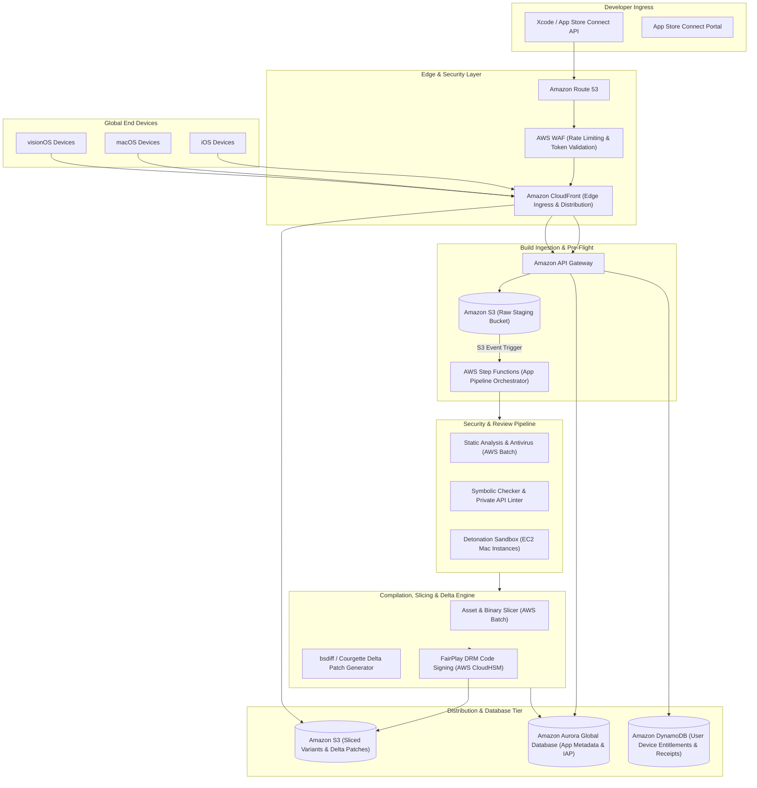
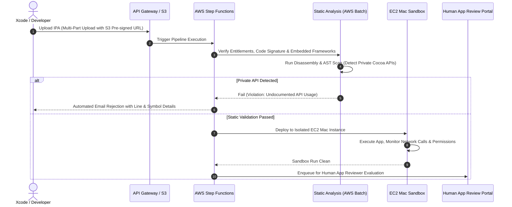
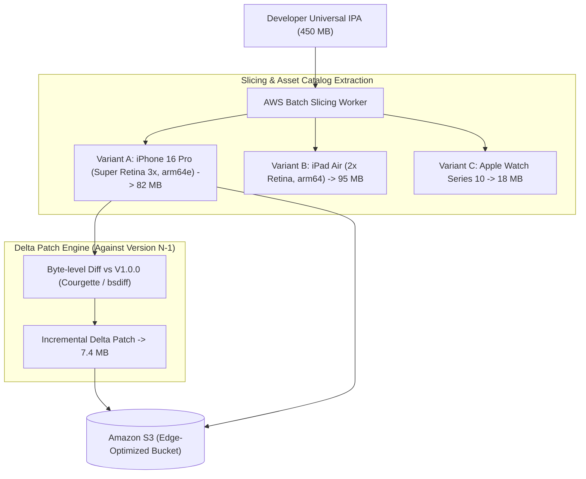
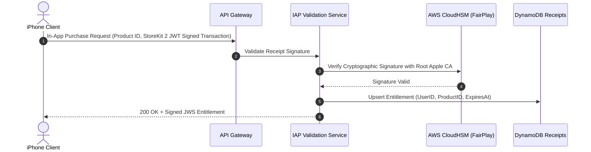

# Real-World AWS Architecture: Apple App Store (Global Digital Distribution & Review Platform)

> **Architecture Exercise**: How to architect a global digital application distribution platform on AWS (like the Apple App Store) that manages developer binary uploads, automated malware & private API inspection pipelines, device-specific App Thinning & Slicing, delta-patch generation, FairPlay DRM signing, and global low-latency downloads.

---

## Table of Contents
1. [Business & Engineering Context](#1-business--engineering-context)
2. [Target Scale & Engineering Constraints](#2-target-scale--engineering-constraints)
3. [End-to-End AWS System Architecture](#3-end-to-end-aws-system-architecture)
4. [The Binary Ingestion, Malware Scan & Review Pipeline](#4-the-binary-ingestion-malware-scan--review-pipeline)
5. [App Thinning, Slicing & Delta Patch Engine](#5-app-thinning-slicing--delta-patch-engine)
6. [FairPlay DRM Code Signing & In-App Purchase (IAP) Verification](#6-fairplay-drm-code-signing--in-app-purchase-iap-verification)
7. [Global Content Delivery Strategy](#7-global-content-delivery-strategy)
8. [AWS Well-Architected Framework Assessment](#8-aws-well-architected-framework-assessment)
9. [Architecture Challenges & Practice Interview Questions](#9-architecture-challenges--practice-interview-questions)

---

## 1. Business & Engineering Context

The Apple App Store serves over **1.5 billion active Apple devices** (iPhones, iPads, Macs, Apple Watches, Apple Vision Pro). The system must securely process developer submissions, evaluate regulatory and security compliance, compile and slice binaries for diverse chip architectures (A16, A17 Pro, M-series chips), and distribute multi-gigabyte apps at global scale with zero corruption.

### Key Architectural Pillars
1. **Developer Ingestion & Verification**: Translocating developer IPAs via Xcode/Transporter, verifying provisioning profiles, certificates, and entitlements.
2. **Automated Static & Dynamic Security Sandbox**: Running disassemblers, private API call detectors, and anti-malware sandboxes.
3. **App Thinning (Slicing & Bitcode/ODR)**: Extracting only the necessary 2x/3x image assets and CPU slices so an iPhone does not download iPad or Mac assets.
4. **Byte-Level Delta Updates**: Generating cryptographic diffs so app updates only transfer the changed bytes (e.g., 8 MB patch instead of 250 MB download).
5. **FairPlay DRM & Store Licensing**: Cryptographically wrapping the executable per user purchase transaction.

---

## 2. Target Scale & Engineering Constraints

### Scale Metrics (Back-of-the-Envelope)
* **Active Devices**: ~1.8 Billion devices globally.
* **Daily App Downloads & Updates**: ~350,000,000 downloads/day (~4,000 downloads/sec average, peaking at **25,000 downloads/sec** during iOS launch days).
* **Developer Submissions**: ~100,000 new builds uploaded daily.
* **Storage Footprint**: Petabytes of compiled, signed, and sliced variants stored securely across storage classes.

### Non-Functional Requirements (SLAs)
| Dimension | Target SLA | Architectural Enabler |
| :--- | :--- | :--- |
| **Download Time-To-First-Byte (TTFB)** | < 35ms (p99) | Amazon CloudFront Edge Locations with Origin Shield |
| **App Processing Pipeline** | < 20 mins for full slice/sign | AWS Batch with parallelized EC2 Graviton/macOS instances |
| **Integrity & Security Guarantee** | 100% cryptographic validation | AWS KMS Customer Managed Keys + Hardware Security Modules (HSM) |
| **In-App Purchase Validation Latency** | < 80ms (p99) | Multi-Region Aurora Global Database + ElastiCache Redis |

---

## 3. End-to-End AWS System Architecture

---

## 4. The Binary Ingestion, Malware Scan & Review Pipeline

When a developer submits a build via Xcode, the package enters an automated verification pipeline:

---

## 5. App Thinning, Slicing & Delta Patch Engine

To ensure an iPhone 16 does not download heavy assets intended for an iPad Pro or Apple Watch, the backend performs **App Slicing**:

* **Storage Organization**: S3 stores sliced variants partitioned by `app_id/version/device_family/build_id`.
* **Download Savings**: Users upgrading from version 1.0 to 1.1 download only a **7.4 MB delta patch** rather than redownloading the entire 82 MB app slice.

---

## 6. FairPlay DRM Code Signing & In-App Purchase (IAP) Verification

Every app executable downloaded from the store is personalized and encrypted with **Apple FairPlay DRM**:
* The client's unique hardware identifier and Apple ID receipt are bound together.
* Key generation and master signing keys are guarded inside **AWS CloudHSM** (FIPS 140-2 Level 3 compliant hardware security modules) with zero human access to raw private keys.

---

## 7. Global Content Delivery Strategy

* **Amazon CloudFront Origin Shield**: Regional caching hubs in North America, Europe, Asia, and Middle East aggregate traffic, preventing download spikes during major game launches from overwhelming the S3 origin buckets.
* **Range Requests (HTTP 206 Partial Content)**: If an iPhone drops Wi-Fi midway through a 3 GB game download, it resumes at the exact byte offset without restarting.

---

## 8. AWS Well-Architected Framework Assessment

| Pillar | Architectural Strategy in this Case |
| :--- | :--- |
| **Operational Excellence** | Blue/green pipeline deployments; synthetic monitoring downloading top 50 apps continuously across 15 global edge regions to measure download throughput and latency. |
| **Security** | Zero-trust developer isolation; compilation sandboxes in single-tenant **EC2 Mac instances** with automated EBS sanitization after each build run. Dedicated AWS CloudHSM clusters for DRM signing. |
| **Reliability** | Multi-region replication for metadata and user entitlements; S3 Cross-Region Replication (CRR) ensuring app binaries are available even if an entire AWS region experiences service disruption. |
| **Performance Efficiency** | Byte-level delta compression reducing bandwidth consumption by over 70%; CloudFront HTTP/3 support reducing handshake latency over cellular networks. |
| **Cost Optimization** | S3 Intelligent-Tiering automatically transitions older app versions to S3 Glacier Flexible Deep Archive after 90 days. |

---

## 9. Architecture Challenges & Practice Interview Questions

### Challenge 1: The "Worldwide iOS Release Day" Thundering Herd
* **Scenario**: Apple launches iOS update and major apps release day-one patches. Global download traffic jumps from 5 Tbps to 40 Tbps within 1 hour.
* **Design Solution**:
  1. Staggered rollout phases: App Store releases support phased 7-day automated rollouts (1%, 2%, 5%, 10%, 20%, 50%, 100%).
  2. Edge Pre-Warming: Top 1,000 apps are pre-warmed into CloudFront edge caches and ISP-level caches 12 hours prior to the event.
  3. Client-side jitter: The iOS App Store background daemon introduces a randomized delay (0–120 minutes) for automatic background app updates.

### Challenge 2: Zero-Day Malware Detonation in App Submissions
* **Scenario**: A malicious app passes static checks by decrypting malicious payloads dynamically from an external command & control server after launching.
* **Design Solution**:
  * The **EC2 Mac Detonation Sandbox** routes all outbound network traffic through an inline **AWS Network Firewall / Suricata IDS**.
  * The sandbox runs heuristic analysis on API call sequences, filesystem tampering, and unauthorized background location tracking, instantly flagging suspicious network beacons.
