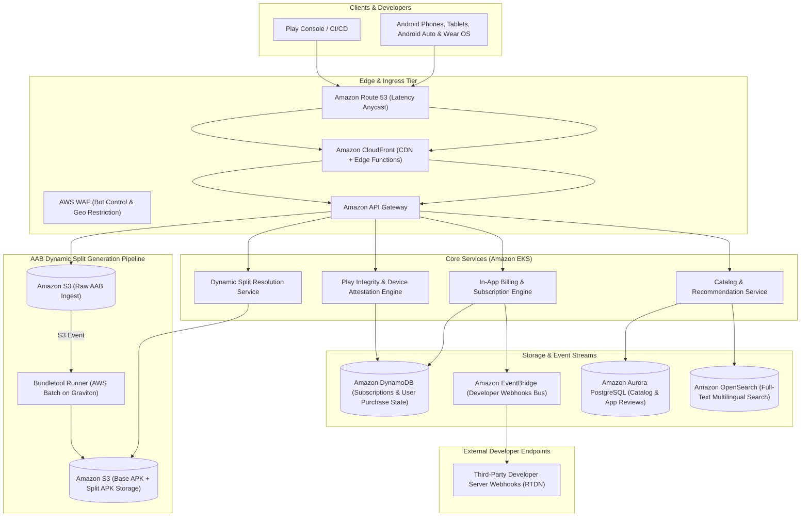
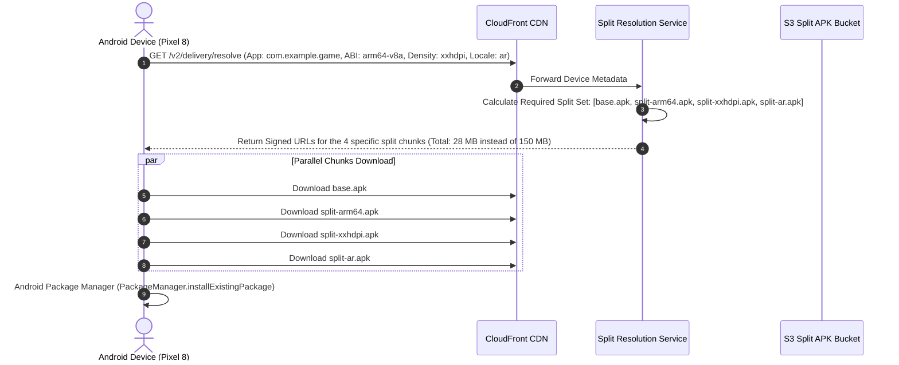
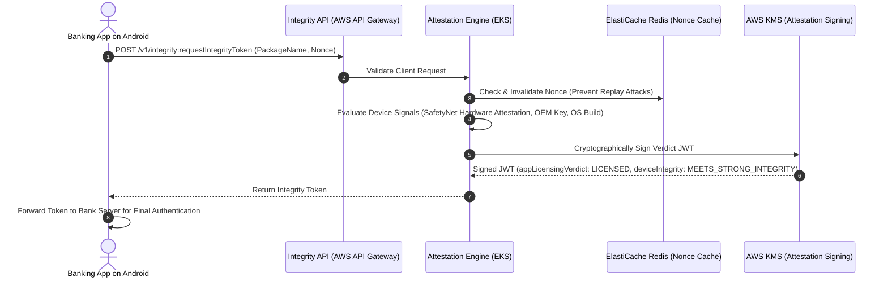
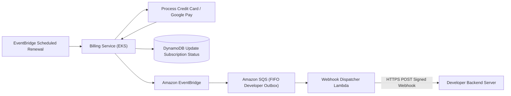

# Real-World AWS Architecture: Google Play Store (Dynamic App Delivery & Ecosystem Platform)

> **Architecture Exercise**: How to architect a global Android application and digital content delivery platform on AWS (modeled on the Google Play Store) featuring Android App Bundle (AAB) split generation, on-demand dynamic feature delivery, real-time Play Integrity device attestation, and high-concurrency In-App Billing subscriptions.

---

## Table of Contents
1. [Business & Engineering Context](#1-business--engineering-context)
2. [Target Scale & Engineering Constraints](#2-target-scale--engineering-constraints)
3. [End-to-End AWS System Architecture](#3-end-to-end-aws-system-architecture)
4. [Android App Bundle (AAB) & Dynamic Split Delivery](#4-android-app-bundle-aab--dynamic-split-delivery)
5. [Play Integrity Attestation & Anti-Abuse Engine](#5-play-integrity-attestation--anti-abuse-engine)
6. [In-App Billing & Real-Time Developer Notifications (RTDN)](#6-in-app-billing--real-time-developer-notifications-rtdn)
7. [AWS Well-Architected Framework Assessment](#7-aws-well-architected-framework-assessment)
8. [Architecture Challenges & Practice Interview Questions](#8-architecture-challenges--practice-interview-questions)

---

## 1. Business & Engineering Context

Google Play reaches over **3 billion monthly active Android users** across thousands of distinct device manufacturers (Samsung, Xiaomi, Google Pixel, Motorola) with differing CPU architectures (arm64-v8a, armeabi-v7a, x86_64), screen densities (hdpi, xxhdpi, xxxhdpi), and language localizations.

### Key Functional Systems
1. **App Bundle (AAB) Ingestion & Split Generation**: Developers upload a single `.aab` archive; the platform extracts and pre-compiles hundreds of modular split APKs.
2. **Dynamic Feature Delivery**: Allows users to download only the core app initially, streaming optional modules (e.g., Level 2 in a game, AR camera filters) on-demand when requested by the user.
3. **Play Integrity Attestation**: Validating that an app is running on an uncompromised, genuine Android device (detecting unlocked bootloaders, rooting, Magisk, or emulator bots).
4. **Subscription Lifecycle & Webhooks**: Handling billing renewals, grace periods, account holds, and emitting low-latency webhooks to third-party developer backends.

---

## 2. Target Scale & Engineering Constraints

### Scale Metrics (Back-of-the-Envelope)
* **Active Devices**: 3,000,000,000 Android devices globally.
* **Daily App Downloads & Updates**: ~400,000,000 requests/day.
* **Peak Query Throughput**: ~40,000 API requests/sec (catalog browsing, updates checking, license verification).
* **Integrity Attestation Tokens**: ~15,000 validations/sec from banking, gaming, and enterprise apps.

### Non-Functional Requirements (SLAs)
| Requirement | Target SLA | Architectural Enabler |
| :--- | :--- | :--- |
| **Catalog API Latency** | < 45ms (p95) | CloudFront Edge caching + DynamoDB DAX in-memory acceleration |
| **Integrity Attestation Check** | < 100ms (p99) | AWS Lambda @ Edge or Regional API Gateway with ElastiCache Redis |
| **Dynamic Feature Download TTFB** | < 25ms (p95) | S3 Regional Buckets + CloudFront Origin Shield |
| **Subscription Event Delivery** | < 500ms | Amazon EventBridge + SQS FIFO Queues |

---

## 3. End-to-End AWS System Architecture

---

## 4. Android App Bundle (AAB) & Dynamic Split Delivery

Instead of shipping a single bloated 150 MB universal APK to every phone, the architecture generates and serves tailored split APKs:

---

## 5. Play Integrity Attestation & Anti-Abuse Engine

When an Android banking or gaming app launches, it requests an **Integrity Verdict** to verify the device environment has not been tampered with:

---

## 6. In-App Billing & Real-Time Developer Notifications (RTDN)

When an annual subscription renews, the transaction must immediately notify external developer servers:

---

## 7. AWS Well-Architected Framework Assessment

| Pillar | Strategy in Google Play Store Architecture |
| :--- | :--- |
| **Operational Excellence** | Blue/Green cluster upgrades for EKS; automated canary analysis using Spinnaker or ArgoCD; comprehensive CloudWatch Container Insights metrics. |
| **Security** | Hardware attestation verified via AWS KMS; tamper-evident logging via AWS CloudTrail; TLS 1.3 enforced across all public endpoints. |
| **Reliability** | Multi-AZ deployment across 3 availability zones; SQS FIFO queues with exponential backoff and dead-letter queues (DLQ) for guaranteed webhook delivery. |
| **Performance Efficiency** | Split APK packaging reduces average install sizes by 65%, dramatically accelerating install speeds over mobile cellular networks. |
| **Cost Optimization** | Dynamic split generation executed on **AWS Graviton3** spot instances via AWS Batch, reducing compute build costs by up to 60%. |

---

## 8. Architecture Challenges & Practice Interview Questions

### Challenge 1: The "Dynamic Feature Module" On-Demand Download Failure
* **Problem**: A user plays a game and reaches Level 10. The game triggers an on-demand download for the Level 10 asset pack, but cellular connectivity drops temporarily.
* **Solution**:
  1. The client library uses the `PlayCore` split-installer background session with resumable byte-range HTTP requests.
  2. If the connection fails, the download is paused and automatically resumed when connectivity returns, without losing previously downloaded progress.

### Challenge 2: Mitigating Subscription Webhook Floods
* **Problem**: At the first day of every month, 5 million subscription renewal webhooks fire simultaneously, threatening to overwhelm third-party developer webhooks.
* **Solution**:
  * An Amazon SQS FIFO queue with customer-based grouping partitions the outgoing webhooks.
  * AWS Lambda throttles outgoing calls per developer domain to match their registered rate-limit tiers, preventing unintended denial-of-service on developer servers.
