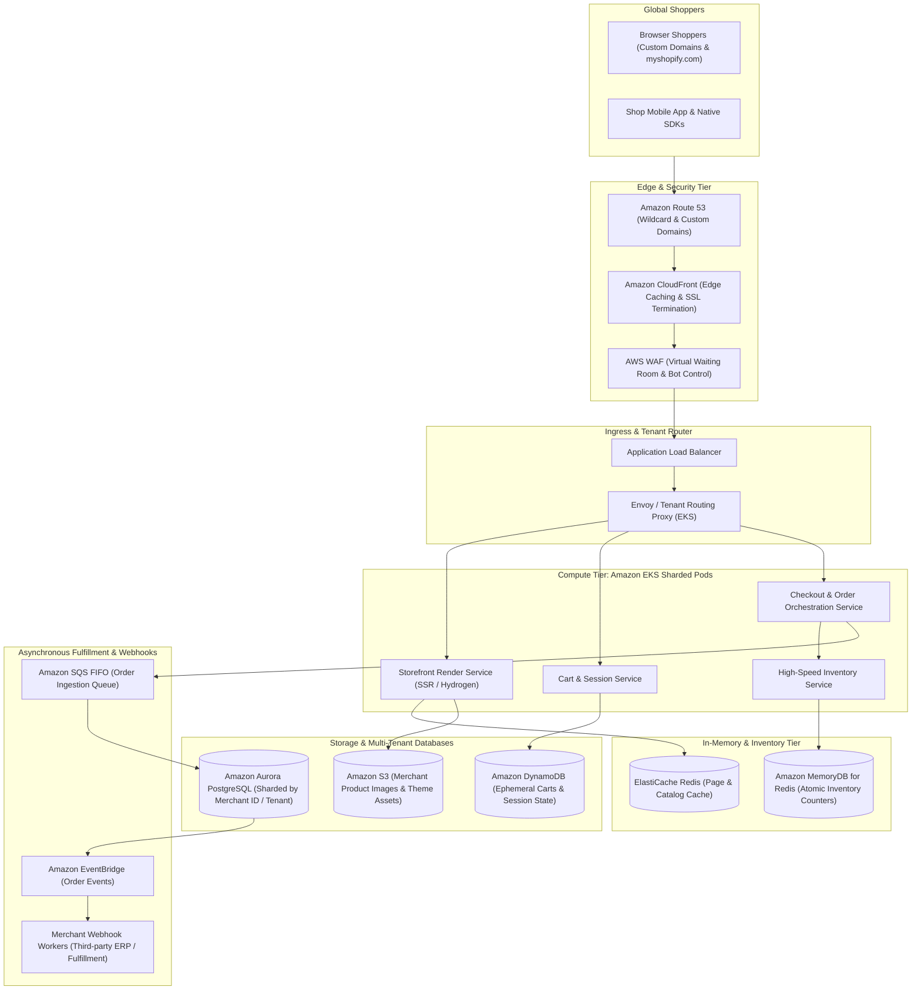
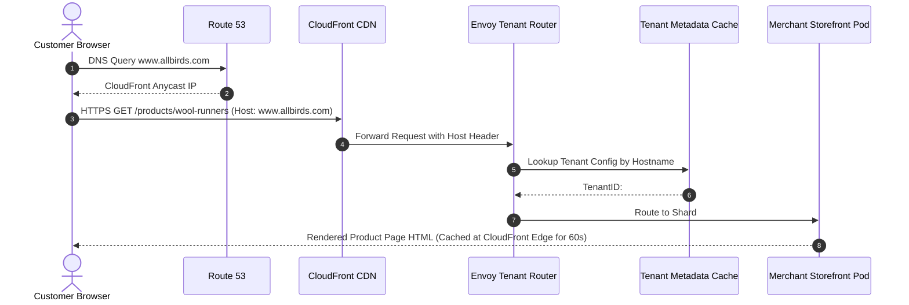
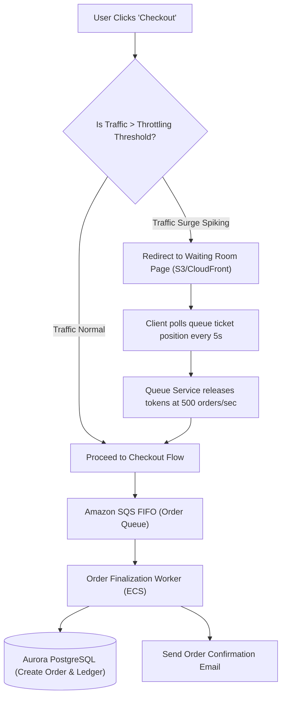

# Real-World AWS Architecture: Shopify (Multi-Tenant E-Commerce & Flash Sale Platform)

[](https://aws.amazon.com/architecture/well-architected/)
[]()
[]()

> **Architecture Exercise**: How to architect a global multi-tenant e-commerce platform on AWS (like Shopify) capable of handling millions of independent merchant storefronts, custom domains, high-concurrency flash sales (e.g., Black Friday / Cyber Monday), sub-second inventory reservation, and zero-downtime checkout sagas.

---

## Table of Contents
1. [Business & Engineering Context](#1-business--engineering-context)
2. [Target Scale & Engineering Constraints](#2-target-scale--engineering-constraints)
3. [End-to-End AWS System Architecture](#3-end-to-end-aws-system-architecture)
4. [Multi-Tenant Storefront Isolation & Routing](#4-multi-tenant-storefront-isolation--routing)
5. [Flash Sale Inventory Reservation & Lock-Free Slicing](#5-flash-sale-inventory-reservation--lock-free-slicing)
6. [Resilient Checkout Saga & Virtual Waiting Room](#6-resilient-checkout-saga--virtual-waiting-room)
7. [AWS Well-Architected Framework Assessment](#7-aws-well-architected-framework-assessment)
8. [Architecture Challenges & Practice Interview Questions](#8-architecture-challenges--practice-interview-questions)

---

## 1. Business & Engineering Context

Shopify powers over **4 million merchants** globally, from boutique shops to enterprise brands (Gymshark, Heinz, Kylie Cosmetics). 

### The Core Architectural Dilemma
* A celebrity merchant announces a limited product drop at 12:00 PM.
* Traffic jumps from 20 requests/sec to **250,000 requests/sec within 3 seconds**.
* 100,000 shoppers attempt to buy an item with only 5,000 units in stock.
* The system must:
  1. Never oversell (prevent negative inventory).
  2. Maintain 100% responsiveness without taking down neighboring merchants sharing the platform.
  3. Ensure checkout transactions complete reliably without double charges.

---

## 2. Target Scale & Engineering Constraints

### Scale Metrics (Black Friday / Cyber Monday Peak)
* **Merchants**: 4,000,000+ active stores.
* **Peak Platform Traffic**: Over **120,000,000 requests/minute** (~2,000,000 requests/sec).
* **Peak Checkout Volume**: Over **$45,000 per second** in GMV.
* **Database Queries**: Over 40,000,000 database operations/sec across sharded clusters.

### Non-Functional Requirements (SLAs)
| Metric | Target SLA | Architectural Enabler |
| :--- | :--- | :--- |
| **Storefront Read Latency** | < 40ms (p99) | CloudFront Edge caching + Lua edge render + ElastiCache Redis |
| **Inventory Decrement Latency** | < 10ms (p99) | Redis distributed counter script / MemoryDB atomic decr |
| **Checkout Saga Durability** | Zero lost orders | Amazon SQS FIFO + Aurora PostgreSQL Multi-AZ |
| **Tenant Isolation** | Strict noisy-neighbor protection | AWS WAF rate-limiting per host + EKS pod resource quotas |

---

## 3. End-to-End AWS System Architecture



---

## 4. Multi-Tenant Storefront Isolation & Routing

Every store has either a subdomain (`merchant.myshopify.com`) or a custom domain (`www.allbirds.com`).



---

## 5. Flash Sale Inventory Reservation & Lock-Free Slicing

Traditional relational `SELECT ... FOR UPDATE` locks dead-lock when 10,000 requests hit the same SKU at the same millisecond. 

Instead, Shopify utilizes an **In-Memory Atomic Redis Lua Script** with inventory bucket slicing:

```lua
-- Atomic Lua Script executed in Amazon MemoryDB / Redis
-- KEYS[1]: inventory:item_sku_101
-- ARGV[1]: quantity_to_reserve (e.g., 1)
-- ARGV[2]: reservation_hold_ttl_seconds (e.g., 600)

local current_stock = tonumber(redis.call('GET', KEYS[1]))

if current_stock == nil then
    return -1 -- SKU does not exist
end

if current_stock >= tonumber(ARGV[1]) then
    redis.call('DECRBY', KEYS[1], ARGV[1])
    return 1 -- Success: Stock successfully reserved
else
    return 0 -- Sold out / Insufficient stock
end
```

### Why this works:
* Lua scripts in Redis execute **single-threaded and atomically** in < 1 millisecond.
* 100,000 shoppers attempting to buy 5,000 units are processed sequentially in RAM. Exactly 5,000 succeed, and 95,000 immediately receive an out-of-stock response without touching the primary SQL database.

---

## 6. Resilient Checkout Saga & Virtual Waiting Room

During extreme flash sales, **AWS WAF and CloudFront Functions** enforce a Virtual Waiting Room to protect the checkout backend:



---

## 7. AWS Well-Architected Framework Assessment

| Pillar | Architectural Strategy in Shopify on AWS |
| :--- | :--- |
| **Operational Excellence** | Blue/Green Canary rollouts with automated rollbacks if error rate exceeds 0.01%; distributed tracing with AWS X-Ray tagging requests with `tenant_id`. |
| **Security** | Automated wildcard and customer SSL certificate provisioning via **AWS Certificate Manager (ACM)**; strict tenant database isolation preventing cross-tenant data leaks. |
| **Reliability** | Sharded database architecture (each Aurora cluster hosts ~10,000 merchants). If one cluster has an issue, 99.7% of other merchants remain unaffected. |
| **Performance Efficiency** | Atomic Lua scripts in MemoryDB provide sub-millisecond inventory decisions; CloudFront edge rendering speeds up global storefront browsing. |
| **Cost Optimization** | Ephemeral shopping cart sessions stored in DynamoDB with **TTL (Time to Live)** set to 7 days, automatically purging abandoned carts without batch delete scripts. |

---

## 8. Architecture Challenges & Practice Interview Questions

### Challenge 1: The Abandoned Cart Inventory Leak
* **Problem**: 5,000 shoppers reserve items during a flash sale, but 3,000 abandon their cart without completing payment. The product appears "Sold Out" while inventory sits idle.
* **Solution**:
  1. The reservation in Redis has an associated TTL (e.g., 10 minutes).
  2. A scheduled step in **AWS Step Functions** or **EventBridge Scheduler** is set for `now + 10 minutes`.
  3. If payment is not completed within 10 minutes, the state machine triggers a compensating transaction:
     `INCRBY inventory:item_sku_101 1`
  4. The reserved stock is returned to the pool for waiting shoppers.

### Challenge 2: Noisy Neighbor Threat During Flash Sales
* **Problem**: A massive merchant drop creates millions of requests, consuming all ALB connection slots and exhausting database connection pools for neighboring merchants on the same cluster.
* **Solution**:
  * Implement **Bulkheading**: Large enterprise merchants (Shopify Plus) are dynamically assigned dedicated read replicas and separate EKS worker node pools.
  * AWS WAF applies per-tenant rate limits on the host header, isolating anomalous traffic spikes before they reach internal application pods.
