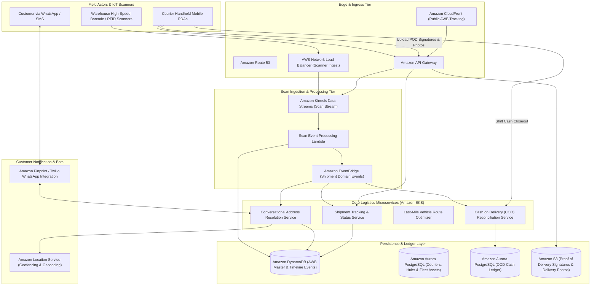
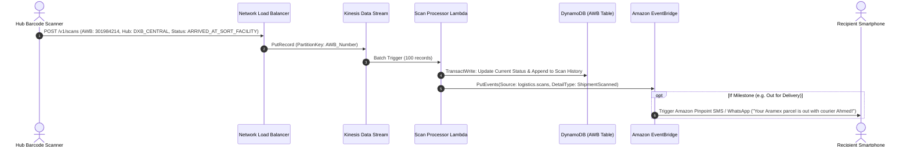
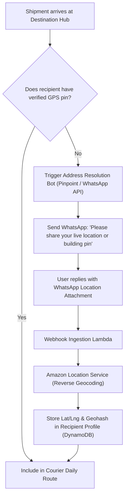

# Real-World AWS Architecture: Aramex (Express Logistics & Last-Mile Delivery Platform)

> **Architecture Exercise**: How to architect a global express courier and last-mile logistics platform on AWS (like Aramex) supporting Air Waybill (AWB) lifecycle tracking, optical barcode scanning at sorting facilities, WhatsApp geolocation address collection, automated Cash on Delivery (COD) reconciliation, and courier route optimization.

---

## Table of Contents
1. [Business & Engineering Context](#1-business--engineering-context)
2. [Target Scale & Engineering Constraints](#2-target-scale--engineering-constraints)
3. [End-to-End AWS System Architecture](#3-end-to-end-aws-system-architecture)
4. [The High-Volume Barcode Scan Ingestion Pipeline](#4-the-high-volume-barcode-scan-ingestion-pipeline)
5. [WhatsApp Address Geolocation Bot & Address Resolution Engine](#5-whatsapp-address-geolocation-bot--address-resolution-engine)
6. [Last-Mile Courier Route Optimization & COD Reconciliation](#6-last-mile-courier-route-optimization--cod-reconciliation)
7. [AWS Well-Architected Framework Assessment](#7-aws-well-architected-framework-assessment)
8. [Architecture Challenges & Practice Interview Questions](#8-architecture-challenges--practice-interview-questions)

---

## 1. Business & Engineering Context

Aramex is the leading multinational logistics, courier, and package delivery company in the Middle East and emerging markets. The network handles cross-border e-commerce shipments, freight forwarding, customs clearance, and last-mile courier delivery.

### Key Operational Challenges in Emerging Markets
1. **Unstructured Addresses**: In many cities across the Middle East, street names and postal zip codes are frequently incomplete or non-standardized. Logistics platforms must dynamically resolve addresses via conversational bots (WhatsApp/SMS) and GPS pins.
2. **Cash on Delivery (COD)**: Over 40% of shipments in certain regions are paid in cash upon physical receipt. Couriers act as mobile banking agents requiring strict reconciliation before end-of-shift cash deposits.
3. **High-Velocity Barcode / RFID Scans**: Every parcel is scanned 8–15 times throughout its transit journey (Origin Depot $\rightarrow$ Airport $\rightarrow$ Customs $\rightarrow$ Sorting Hub $\rightarrow$ Local Distribution Center $\rightarrow$ Delivery Van $\rightarrow$ Customer Doorstep).

---

## 2. Target Scale & Engineering Constraints

### Scale Metrics (Back-of-the-Envelope)
* **Daily Shipments Processed**: ~1,800,000 parcels/day.
* **Scan Events Ingested**: ~20,000,000 barcode/RFID scan events/day (~230 scans/sec average, peaking at **3,500 scans/sec** during evening hub sorting).
* **Active Courier Fleets**: 25,000 couriers across 65+ countries.
* **Tracking Queries**: ~15,000,000 public AWB status lookups/day.

### Non-Functional Requirements (SLAs)
| Metric | Target SLA | Architectural Enabler |
| :--- | :--- | :--- |
| **AWB Tracking Latency** | < 50ms (p99) | CloudFront Edge caching + DynamoDB Single-Table Design |
| **Scan Event Ingestion Lag** | < 2 seconds | Amazon Kinesis Data Streams + AWS Lambda Consumers |
| **Address Geocoding Accuracy** | Pin within 15 meters | Amazon Location Service + OpenStreetMap/Google Maps API |
| **COD Reconciliation Audit** | 100% Zero-Loss Ledger | Amazon Aurora PostgreSQL Multi-AZ with strict audit logging |

---

## 3. End-to-End AWS System Architecture

---

## 4. The High-Volume Barcode Scan Ingestion Pipeline

Every time an automated conveyor belt or courier scans a parcel, an immutable scan record is created:

---

## 5. WhatsApp Address Geolocation Bot & Address Resolution Engine

To solve unstructured Middle Eastern addresses, the architecture coordinates an automated WhatsApp conversation before the driver leaves the station:

---

## 6. Last-Mile Courier Route Optimization & COD Reconciliation

### Route Optimization
* At 6:00 AM, thousands of parcels are grouped into delivery clusters using **Amazon Location Service route matrices** and vehicle routing solvers on **AWS Batch**.
* Couriers receive an optimized sequence of stops minimizing traffic congestion and left turns.

### Cash on Delivery (COD) Pipeline
* When a delivery is completed with cash collection:
  1. The courier enters the exact collected amount into their PDA.
  2. The customer signs on screen; signature image uploads to **Amazon S3**.
  3. A temporary credit is posted to the courier's physical cash custody ledger in **Amazon Aurora**.
  4. At the end of the shift, the courier deposits the collected cash into a Smart Safe at the depot, which verifies the notes and triggers an automated settlement.

---

## 7. AWS Well-Architected Framework Assessment

| Pillar | Architectural Strategy in Aramex Logistics on AWS |
| :--- | :--- |
| **Operational Excellence** | End-to-end parcel tracking telemetry monitored via **Amazon CloudWatch Contributor Insights** to pinpoint sorting hubs with scanning bottlenecks or backlog queues. |
| **Security** | Signatures and recipient identity documents stored in S3 encrypted with **AWS KMS**; strict IAM role separation between customer tracking APIs and internal depot systems. |
| **Reliability** | Kinesis stream buffering guarantees that sudden bursts from high-speed sorting machines (e.g. 5,000 scans/sec during midnight hub sort) do not overwhelm persistence databases. |
| **Performance Efficiency** | AWB tracking queries cached at **Amazon CloudFront** edge nodes with a 30-second TTL, shielding the origin database from millions of repeated refresh queries by anxious recipients. |
| **Cost Optimization** | Scan history tables in DynamoDB leverage automated TTL to archive historical tracking logs to S3 Glacier Flexible Deep Archive after 180 days. |

---

## 8. Architecture Challenges & Practice Interview Questions

### Challenge 1: The "Black Friday" Sorting Hub Backlog
* **Problem**: During Singles' Day / Black Friday, an automated conveyor scanner creates 10x normal scan volume. The downstream database slows down, threatening to halt physical conveyor lines.
* **Solution**:
  1. Conveyor scan devices buffer events locally in an offline-capable SQLite database on the edge controller (AWS IoT Greengrass).
  2. Edge devices push batches asynchronously to **Amazon Kinesis Data Streams**, which scales shards automatically via Application Auto Scaling.
  3. Physical conveyor sorters make instantaneous routing decisions based on local edge rules without waiting for cloud round-trip confirmation.

### Challenge 2: Disputed Cash on Delivery (COD) Deliveries
* **Problem**: A customer claims they paid the courier $100, but the courier records $80 in their PDA.
* **Solution**:
  * Implement an immutable **Double-Entry Financial Audit Trail** in Amazon Aurora with digital OTP verification.
  * The customer must provide an SMS/WhatsApp OTP code to the courier before the delivery status can transition to `DELIVERED_CASH_COLLECTED`, legally proving customer physical confirmation.
