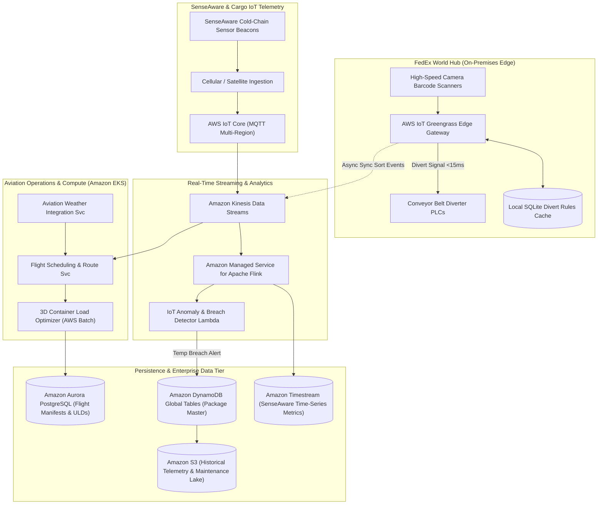
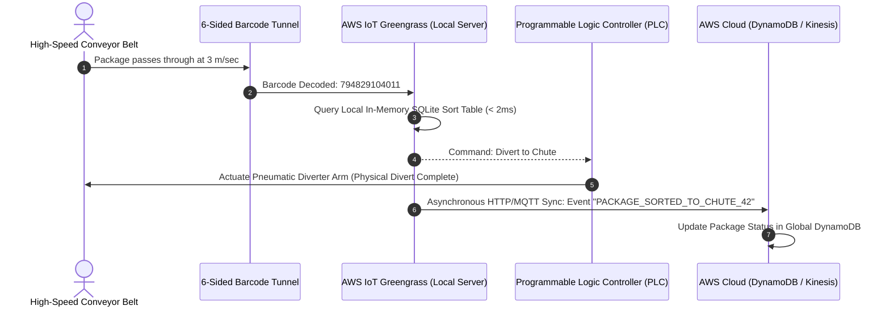
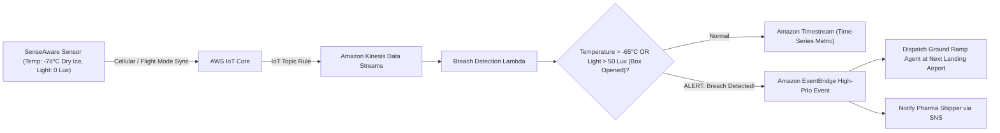
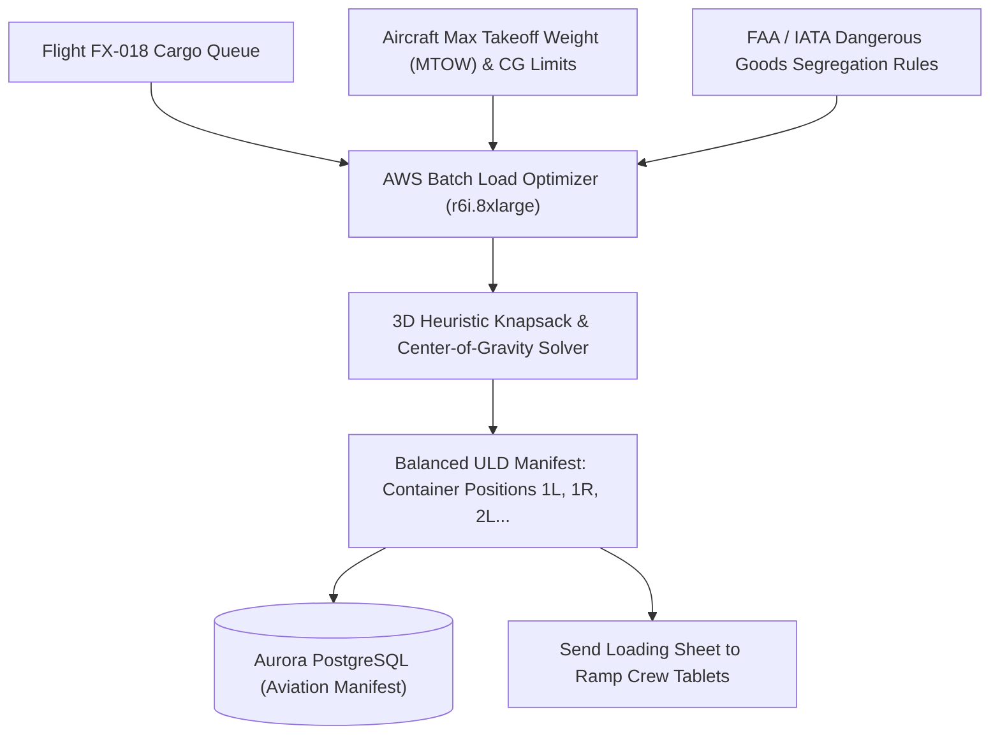

# Real-World AWS Architecture: FedEx (Global Superhub Logistics & SenseAware IoT Telemetry)

> **Architecture Exercise**: How to architect a global air-freight superhub and intelligent package sorting platform on AWS (modeled on FedEx World Hub) with hybrid edge conveyor sorting, SenseAware IoT multi-sensor telemetry (temperature, light, vibration), flight weight & balance optimization, and predictive package delay forecasting.

---

## Table of Contents
1. [Business & Engineering Context](#1-business--engineering-context)
2. [Target Scale & Engineering Constraints](#2-target-scale--engineering-constraints)
3. [End-to-End AWS System Architecture](#3-end-to-end-aws-system-architecture)
4. [Hybrid Edge Conveyor Sorting (AWS IoT Greengrass + PLCs)](#4-hybrid-edge-conveyor-sorting-aws-iot-greengrass--plcs)
5. [SenseAware IoT Multi-Sensor Telemetry Pipeline](#5-senseaware-iot-multi-sensor-telemetry-pipeline)
6. [Air Freight Flight Load Planning & 3D Bin Packing](#6-air-freight-flight-load-planning--3d-bin-packing)
7. [AWS Well-Architected Framework Assessment](#7-aws-well-architected-framework-assessment)
8. [Architecture Challenges & Practice Interview Questions](#8-architecture-challenges--practice-interview-questions)

---

## 1. Business & Engineering Context

FedEx connects over **220 countries and territories**, operating hundreds of cargo aircraft (Boeing 777F, MD-11F). Its global superhubs (e.g., Memphis World Hub) sort hundreds of thousands of parcels every hour within tight 3-hour flight turnaround windows.

### Primary Engineering Capabilities
1. **Ultra-Low Latency Hub Conveyor Sorting**: Optical scanners on miles of high-speed conveyor belts must make divert decisions (chute selection) in **under 15 milliseconds** at the physical edge.
2. **Critical SenseAware IoT Telemetry**: Tracking high-value pharmaceutical cold chain shipments (vaccines, gene therapies) with sensors monitoring temperature, shock, light exposure (box opened), and atmospheric pressure.
3. **Flight Load & Center-of-Gravity Optimization**: Dynamically calculating cargo container (ULD) assignments to balance aircraft weight distribution and maximize fuel efficiency.
4. **Predictive Delay Modeling**: Anticipating severe weather bottlenecks at major airports and rerouting freight before flights depart.

---

## 2. Target Scale & Engineering Constraints

### Scale Metrics (Back-of-the-Envelope)
* **Packages Sorted per Superhub**: ~500,000 packages/hour during the night sort window (~140 packages/sec).
* **Conveyor Divert Decision SLA**: **< 15 milliseconds** at the mechanical edge.
* **SenseAware Active IoT Devices**: 250,000 high-value sensor tags transmitting telemetry every 60 seconds over cellular/satellite.
* **Global Daily Shipments**: ~16,000,000 packages/day.

### Non-Functional Requirements (SLAs)
| Requirement | Target SLA | Architectural Enabler |
| :--- | :--- | :--- |
| **Local Conveyor Divert Latency** | < 15ms | AWS IoT Greengrass running on on-premise industrial edge gateways |
| **IoT Cold-Chain Breach Alert** | < 5 seconds | AWS IoT Core Rule Engine + Amazon SNS / EventBridge |
| **Flight ULD Load Plan Compute** | < 3 minutes per widebody jet | AWS Batch with high-memory compute instances (r6i.8xlarge) |
| **Global Shipment State Availability** | 99.999% | Multi-Region Active-Active DynamoDB Global Tables |

---

## 3. End-to-End AWS System Architecture

---

## 4. Hybrid Edge Conveyor Sorting (AWS IoT Greengrass + PLCs)

Conveyor belts travel at 3 meters/second. Sending requests over public internet to the cloud is impossible for divert decisions.

---

## 5. SenseAware IoT Multi-Sensor Telemetry Pipeline

High-value pharmaceutical boxes contain multi-sensor beacons streaming real-time vitals:

---

## 6. Air Freight Flight Load Planning & 3D Bin Packing

A Boeing 777 freighter carries up to 102,000 kg of cargo in standardized Unit Load Devices (ULDs). The system optimizes weight, volume, and hazardous materials compatibility:

---

## 7. AWS Well-Architected Framework Assessment

| Pillar | Architectural Strategy in FedEx Logistics on AWS |
| :--- | :--- |
| **Operational Excellence** | Hybrid edge nodes managed via **AWS Systems Manager (SSM)** and **IoT Greengrass deployment groups** for zero-touch firmware and rule updates. |
| **Security** | Hardware Secure Elements on SenseAware sensors; X.509 client certificate mutual authentication (mTLS) for all IoT Core connections. |
| **Reliability** | Edge autonomy: Even if the superhub loses internet connectivity to AWS, conveyor sorting operates uninterrupted for up to 48 hours using local edge cache. |
| **Performance Efficiency** | Amazon Timestream handles billions of sensor data points with automated roll-ups; AWS Batch provides elastic compute power for flight turnaround planning. |
| **Cost Optimization** | Sensor time-series data transitions to **Amazon S3 Glacier Flexible Deep Archive** after 90 days, fulfilling aviation regulatory retention at minimum cost. |

---

## 8. Architecture Challenges & Practice Interview Questions

### Challenge 1: The "Aircraft Fuel Burn vs Balance" Optimization
* **Problem**: Placing heavier cargo containers toward the aft (rear) of the aircraft reduces aerodynamic trim drag, saving up to $1,500 in jet fuel per trans-Atlantic flight, but must never exceed certified structural aft Center-of-Gravity (CG) limits.
* **Solution**:
  * AWS Batch runs mixed-integer linear programming (MILP) solvers using AWS Graviton instances.
  * The algorithm calculates the Pareto-optimal loading pattern balancing fuel savings, safety envelopes, and turnaround speed at the destination ramp.

### Challenge 2: Network Blackout During Trans-Oceanic Flights
* **Problem**: Cargo flights crossing the Pacific Ocean lose terrestrial cellular connectivity for 10 hours. SenseAware sensors buffer data locally. Upon landing, 5,000 devices dump 10 hours of buffered sensor telemetry simultaneously.
* **Solution**:
  * Sensors implement exponential backoff with randomized jitter to prevent an avalanche effect on airport cellular towers and AWS IoT Core.
  * AWS IoT Core dynamically scales MQTT connections, and Kinesis Data Streams absorbs the sudden burst without dropped packets.
