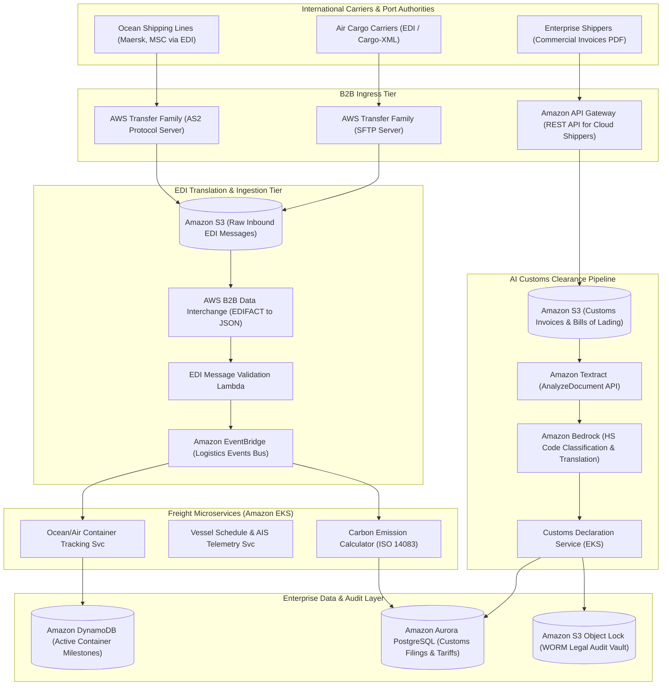
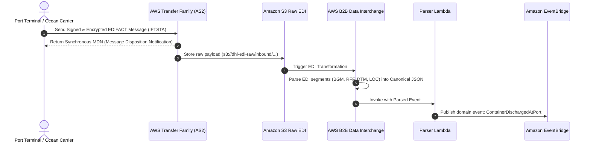
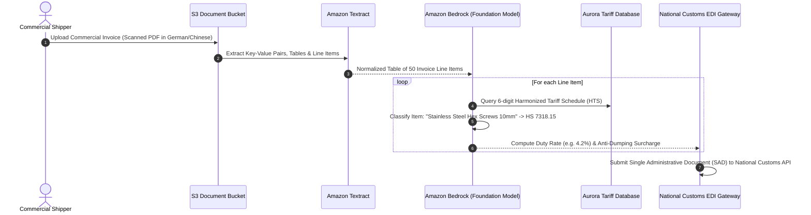

# Real-World AWS Architecture: DHL (Global Forwarding & Automated Customs Clearance)

> **Architecture Exercise**: How to architect a global freight forwarding and automated customs clearance platform on AWS (like DHL Global Forwarding) supporting EDIFACT/X12 B2B partner EDI feeds, Amazon Textract AI-powered commercial invoice processing, automated Harmonized System (HS) code classification, and multi-modal container tracking.

---

## Table of Contents
1. [Business & Engineering Context](#1-business--engineering-context)
2. [Target Scale & Engineering Constraints](#2-target-scale--engineering-constraints)
3. [End-to-End AWS System Architecture](#3-end-to-end-aws-system-architecture)
4. [Legacy B2B EDI Ingestion (AS2 / EDIFACT / X12) on AWS](#4-legacy-b2b-edi-ingestion-as2--edifact--x12-on-aws)
5. [AI-Powered Customs Document Parsing & HS Code Classification](#5-ai-powered-customs-document-parsing--hs-code-classification)
6. [Multi-Modal Container Ocean/Air Milestone Tracking](#6-multi-modal-container-oceanair-milestone-tracking)
7. [GoGreen Carbon Footprint Analytics Engine](#7-gogreen-carbon-footprint-analytics-engine)
8. [AWS Well-Architected Framework Assessment](#8-aws-well-architected-framework-assessment)
9. [Architecture Challenges & Practice Interview Questions](#9-architecture-challenges--practice-interview-questions)

---

## 1. Business & Engineering Context

DHL Global Forwarding coordinates multi-modal supply chains across air, ocean, rail, and road. International freight forwarding involves navigating complex regulatory jurisdictions, interacting with national customs authorities, and ingesting legacy B2B Electronic Data Interchange (EDI) messages.

### Critical Operational Bottlenecks
1. **Paper-Heavy Customs Clearing**: Commercial invoices, packing lists, and bills of lading arrive as unstructured PDFs, scans, and faxes in dozens of languages.
2. **Harmonized Tariff (HS) Code Classification**: Mismatching a 6-to-10 digit HS code leads to customs border impoundment, demurrage penalties, or tax fines.
3. **Legacy EDI Protocols**: Maritime carriers and port authorities communicate via 1980s-era EDIFACT (IFTMIN, IFTSTA) and ANSI X12 formats transmitted over encrypted AS2 or SFTP connections.

---

## 2. Target Scale & Engineering Constraints

### Scale Metrics (Back-of-the-Envelope)
* **Annual Air Freight**: ~2,000,000 metric tons.
* **Annual Ocean Freight**: ~3,200,000 TEU (Twenty-Foot Equivalent Units).
* **Daily Ingested EDI Messages**: ~12,000,000 B2B EDI messages/day.
* **Customs Documents Processed**: ~150,000 international trade documents parsed daily.

### Non-Functional Requirements (SLAs)
| Requirement | Target SLA | Architectural Enabler |
| :--- | :--- | :--- |
| **Customs Document AI Extraction** | < 30 seconds per document | Amazon Textract + Amazon Bedrock (Claude 3.5 Sonnet) |
| **EDI Message Ingestion & Ack** | < 2 seconds (MDN receipt) | AWS Transfer Family (AS2) + AWS B2B Data Interchange |
| **Milestone Tracking Latency** | < 60 seconds from port scan | Amazon EventBridge + Amazon DynamoDB |
| **Compliance Document Retention** | 7–10 Years WORM storage | Amazon S3 Object Lock (Compliance Mode) |

---

## 3. End-to-End AWS System Architecture

---

## 4. Legacy B2B EDI Ingestion (AS2 / EDIFACT / X12) on AWS

Shipping lines communicate via **EDIFACT IFTSTA** (Status Report) and **IFTMIN** (Instruction) messages over **Applicability Statement 2 (AS2)**:

---

## 5. AI-Powered Customs Document Parsing & HS Code Classification

---

## 6. Multi-Modal Container Ocean/Air Milestone Tracking

A shipping container (e.g., `MSKU0918231`) transitions through dozens of physical handoffs:
* **DynamoDB Single-Table Design**:
  * `PK`: `CONTAINER#<container_id>`
  * `SK`: `MILESTONE#<timestamp>`
  * Enables fast retrieval of complete journey timelines in under 20ms for customer portals.

---

## 7. GoGreen Carbon Footprint Analytics Engine

In compliance with European ESG regulations and the **Global Logistics Emissions Council (GLEC)** framework:
* Every freight leg calculates $CO_2e$ emissions:
  $$\text{Emissions (kg } CO_2e) = \text{Distance (km)} \times \text{Cargo Weight (tons)} \times \text{Emission Factor (g } CO_2 / \text{ton-km)}$$
* Calculated asynchronously via **Amazon EventBridge** and aggregated in **Amazon Redshift Serverless** for customer sustainability dashboards.

---

## 8. AWS Well-Architected Framework Assessment

| Pillar | Architectural Strategy in DHL Freight on AWS |
| :--- | :--- |
| **Operational Excellence** | Automated EDI schema drift detection; Dead-letter queues (DLQ) alert operations if an ocean carrier introduces unsupported non-standard EDI qualifiers. |
| **Security** | Trade documents stored in **Amazon S3 Object Lock in Compliance Mode**, preventing any deletion or alteration for 7 years to meet international customs regulations. |
| **Reliability** | Multi-region active-passive disaster recovery for core customs filing microservices, ensuring cross-border clearance never causes border container jams. |
| **Performance Efficiency** | Document OCR processing parallelized across Amazon Textract async jobs; Bedrock batch inference reduces LLM translation latency. |
| **Cost Optimization** | Serverless AS2/SFTP transfer endpoints via **AWS Transfer Family**, eliminating 24/7 dedicated legacy BizTalk / Sterling EDI servers. |

---

## 9. Architecture Challenges & Practice Interview Questions

### Challenge 1: The "Vessel Route Deviation" Event Storm
* **Problem**: A storm in the North Sea forces an ocean container vessel carrying 18,000 containers to divert from Rotterdam to Hamburg, generating 18,000 simultaneous milestone updates and recalculating 18,000 customs declarations.
* **Solution**:
  1. The vessel diversion event emits a single `VESSEL_REROUTED` event to **Amazon EventBridge**.
  2. An **AWS Step Functions Distributed Map** state fan-outs processing in parallel across batches of 500 containers.
  3. Destination customs declarations are automatically canceled in Rotterdam and re-filed in Hamburg without manual clerical intervention.

### Challenge 2: Handling Multilingual Ambiguity in Invoice Extraction
* **Problem**: A Japanese shipper describes parts in technical colloquial jargon that standard OCR fails to map to official WCO tariff books.
* **Solution**:
  * Implement **Retrieval-Augmented Generation (RAG)** using **Amazon Bedrock Knowledge Bases** and **OpenSearch Vector Search**.
  * The system matches the shipper's raw description against historical customs declarations previously accepted by customs officials for that specific commodity code.
