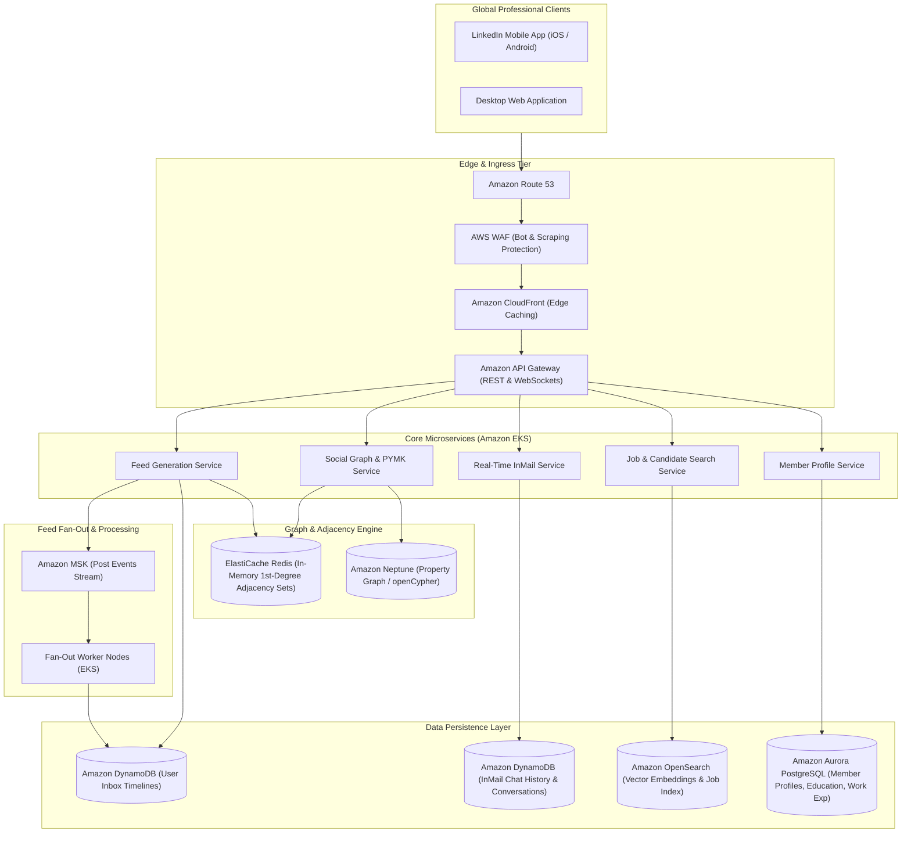
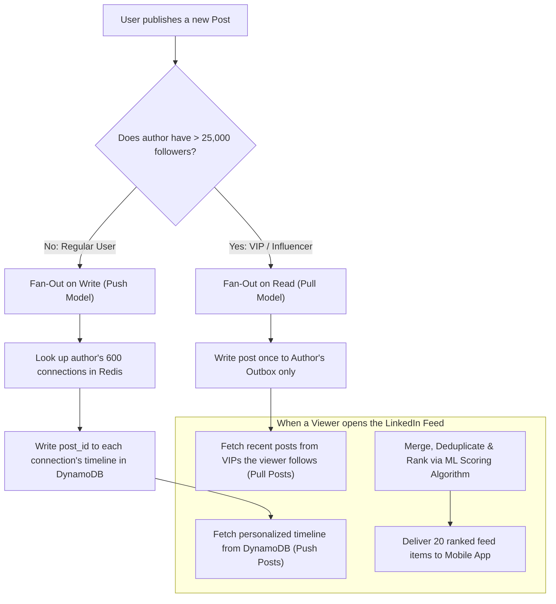
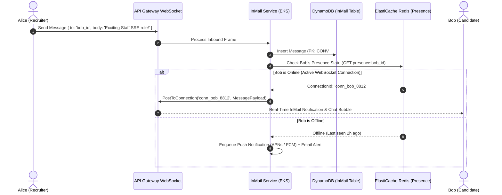
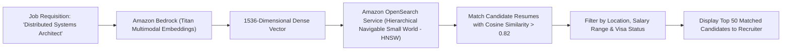

# Real-World AWS Architecture: LinkedIn (Professional Social Graph & Hybrid Feed Engine)

[](https://aws.amazon.com/architecture/well-architected/)
[]()
[]()

> **Architecture Exercise**: How to architect a global professional social network on AWS (like LinkedIn) that executes sub-50ms 1st/2nd/3rd degree connection graph traversals, hybrid fan-out activity feed generation, real-time InMail messaging, and semantic job search.

---

## Table of Contents
1. [Business & Engineering Context](#1-business--engineering-context)
2. [Target Scale & Engineering Constraints](#2-target-scale--engineering-constraints)
3. [End-to-End AWS System Architecture](#3-end-to-end-aws-system-architecture)
4. [The Social Graph Engine (1st, 2nd & 3rd Degree Traversals)](#4-the-social-graph-engine-1st-2nd--3rd-degree-traversals)
5. [Activity Feed Architecture: Hybrid Fan-Out Strategy](#5-activity-feed-architecture-hybrid-fan-out-strategy)
6. [Real-Time InMail Messaging & Presence Pipeline](#6-real-time-inmail-messaging--presence-pipeline)
7. [Semantic Job Search & Candidate Matching](#7-semantic-job-search--candidate-matching)
8. [AWS Well-Architected Framework Assessment](#8-aws-well-architected-framework-assessment)
9. [Architecture Challenges & Practice Interview Questions](#9-architecture-challenges--practice-interview-questions)

---

## 1. Business & Engineering Context

LinkedIn connects over **1 billion professionals** across 200+ countries. The platform centers around the **Economic Graph**: relationships between members, companies, skills, jobs, universities, and content posts.

### Core Architectural Complexities
1. **Multi-Hop Graph Queries**: Determining degree of separation (1st, 2nd, 3rd degree) and generating "People You May Know" (PYMK) recommendations in under 50ms.
2. **Activity Feed Scaling**: When a normal user posts, their 500 connections should receive it immediately. When a celebrity influencer (e.g., Satya Nadella with 10M followers) posts, writing 10,000,000 individual timeline copies (fan-out on write) would cause massive write amplification and crash the cache.
3. **Real-Time Presence & InMail**: Low-latency typing indicators, read receipts, and message delivery.
4. **Vectorized Job Search**: Matching candidates to job requisitions based on semantic skill embeddings rather than rigid keyword matching.

---

## 2. Target Scale & Engineering Constraints

### Scale Metrics (Back-of-the-Envelope)
* **Registered Members**: 1,000,000,000 members.
* **Daily Active Users (DAU)**: ~300,000,000 users.
* **Graph Edges (Connections & Follows)**: > 25 Billion edges.
* **Feed Generation Requests**: ~120,000 feed requests/sec peak.
* **InMail Messages**: ~250,000,000 direct messages/day.

### Non-Functional Requirements (SLAs)
| Metric | Target SLA | Architectural Enabler |
| :--- | :--- | :--- |
| **Feed Generation Latency** | < 120ms (p99) | Hybrid Fan-Out Engine + ElastiCache Redis Cluster |
| **Graph Traversal (1st & 2nd Degree)** | < 35ms | Amazon Neptune (Graph Database) + In-Memory Adjacency Caches |
| **Direct Message Delivery** | < 250ms (p99) | Amazon API Gateway WebSockets + Amazon DynamoDB |
| **Search Relevancy Scoring** | < 150ms | Amazon OpenSearch Service with k-NN Vector Search |

---

## 3. End-to-End AWS System Architecture



---

## 4. The Social Graph Engine (1st, 2nd & 3rd Degree Traversals)

Graph traversals are powered by **Amazon Neptune** using **openCypher**, supplemented by in-memory Redis sets for ultra-low latency 1st-degree lookups.

```mermaid
flowchart LR
    MemberA["Member A"] -->|1st Degree (DIRECT_CONNECT)| MemberB["Member B"]
    MemberB -->|1st Degree (DIRECT_CONNECT)| MemberC["Member C"]
    MemberA -.->|2nd Degree Traversal (35ms)| MemberC

    MemberC -->|1st Degree| MemberD["Member D"]
    MemberA -..->|3rd Degree Traversal| MemberD
```

### openCypher Query Example in Amazon Neptune:
```cypher
// Find 2nd-degree connections who work at 'Amazon' that Member A does not yet know
MATCH (me:Member {id: 'usr_1001'})-[:CONNECTED_TO]-(friend:Member)-[:CONNECTED_TO]-(candidate:Member)
WHERE NOT (me)-[:CONNECTED_TO]-(candidate) AND candidate.company = 'Amazon'
RETURN candidate.name, candidate.headline, count(friend) AS mutual_connections_count
ORDER BY mutual_connections_count DESC
LIMIT 10;
```

---

## 5. Activity Feed Architecture: Hybrid Fan-Out Strategy

The platform solves the **Celebrity / Influencer Problem** via a hybrid fan-out model:



---

## 6. Real-Time InMail Messaging & Presence Pipeline



---

## 7. Semantic Job Search & Candidate Matching

Rather than rigid SQL string matching (`WHERE title LIKE '%Software Engineer%'`), job matching uses **k-NN Vector Embeddings** in **Amazon OpenSearch Service**:



---

## 8. AWS Well-Architected Framework Assessment

| Pillar | Strategy in LinkedIn Architecture on AWS |
| :--- | :--- |
| **Operational Excellence** | Graph and feed telemetry monitored with **AWS X-Ray**; automated tracing identifies latency outliers in complex multi-hop graph queries. |
| **Security** | Member contact info and private InMails encrypted with **AWS KMS**; strict anti-scraping defenses at **AWS WAF** to block automated scrapers harvesting profile data. |
| **Reliability** | Multi-AZ deployment for Amazon Neptune and DynamoDB; hybrid feed fallback ensures a user always gets a cached or fallback feed if the feed ranker times out. |
| **Performance Efficiency** | Hybrid fan-out eliminates write amplification for celebrity accounts; in-memory 1st-degree connection sets in Redis answer 80% of privacy check queries in < 1ms. |
| **Cost Optimization** | Inactive user feed timelines in DynamoDB expire automatically after 30 days of inactivity using native DynamoDB TTL; old media assets transition to S3 Glacier. |

---

## 9. Architecture Challenges & Practice Interview Questions

### Challenge 1: The "Six Degrees of Kevin Bacon" Pathfinding Latency
* **Problem**: A query to calculate the shortest path between two arbitrary members across 1 billion users risks exponential graph fan-out ($O(b^d)$) and query timeouts.
* **Solution**:
  1. Implement **Bidirectional Breadth-First Search (BFS)**: Concurrently search outward from Member A and inward from Member B. The two search fronts intersect at $d/2$ depth, cutting the search space by orders of magnitude.
  2. Cap degree traversals at 3 hops; connections beyond 3rd degree are labeled as `Out of Network` without deep traversal.

### Challenge 2: Instant Feed Refresh on Connection Acceptance
* **Problem**: Member A accepts a connection request from Member B. Member B immediately expects Member A's recent high-engagement posts in their feed.
* **Solution**:
  * The `ConnectionAccepted` event emits to **Amazon MSK**.
  * An asynchronous worker fetches Member A's top 5 recent posts and backfills them into Member B's personalized timeline in DynamoDB within 500ms.
