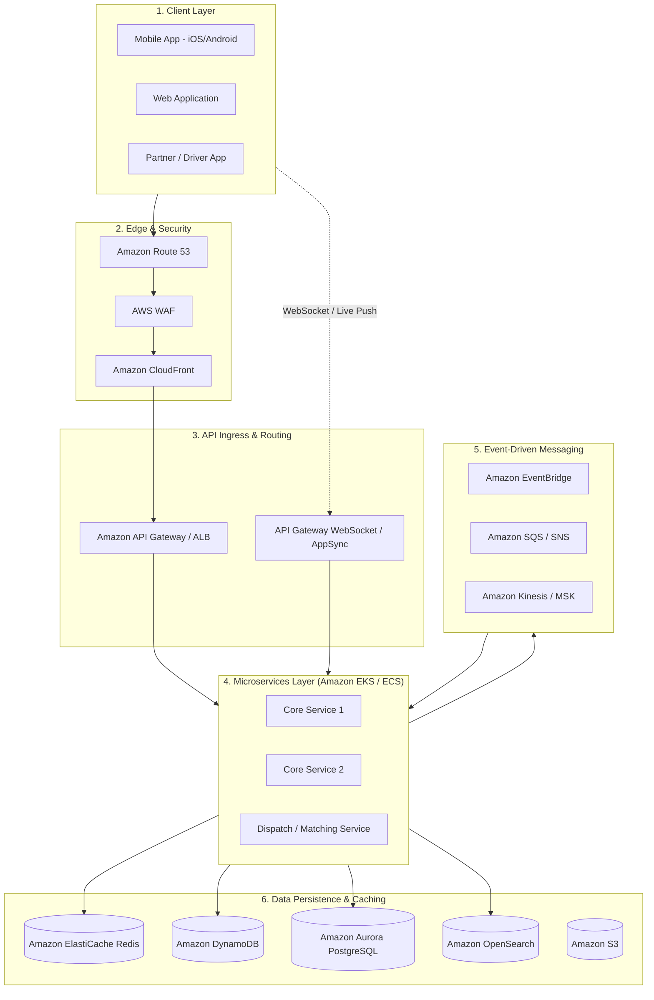
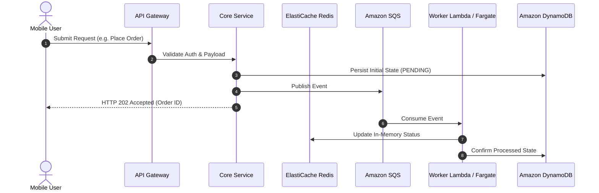

# Use Case Exercise Template: Architecture Blueprint for [Application Name]

> **Exercise Goal**: Design a highly available, scalable, resilient, and cost-effective cloud architecture on AWS for **[Application Name]** (e.g., [Category: Food Delivery / Streaming / Ride Hailing / E-Commerce]).

---

## 1. System Overview & Problem Statement
* **Application Concept**: Brief description of the product and primary value proposition.
* **Key Actors**:
  * **End User / Customer**: (e.g., browsing, ordering, streaming)
  * **Service Provider / Driver / Partner**: (e.g., fulfilling, accepting, delivering)
  * **Internal Operations / Back Office**: (e.g., customer support, dispatch management, analytics)

---

## 2. Requirements & Engineering Constraints

### Functional Requirements
1. Feature 1 (e.g., Catalog Search & Discovery)
2. Feature 2 (e.g., Real-time Matching / Dispatch / Booking)
3. Feature 3 (e.g., Live Tracking & Real-time Updates)
4. Feature 4 (e.g., Checkout, Payments & Invoicing)

### Non-Functional Requirements & SLAs
| Dimension | Target Metric | Architectural Justification |
| :--- | :--- | :--- |
| **Availability** | 99.99% (Four Nines) | Multi-AZ deployment with active-active service routing |
| **Read Latency** | < 50ms (p99) | Edge caching (CloudFront) and in-memory caches (ElastiCache) |
| **Write Latency** | < 150ms (p99) | Asynchronous ingestion with SQS/Kafka and NoSQL stores |
| **Data Consistency** | Eventual vs Strong | Strong consistency for payments/wallet; eventual for catalogs & tracking |
| **Peak Throughput** | [X] QPS / [Y] orders/sec | Elastic scaling via ECS/EKS and Serverless event brokers |

### Back-of-the-Envelope Calculations
* **Daily Active Users (DAU)**: `X million`
* **Peak Requests Per Second (RPS)**: `Y requests/sec`
* **Data Ingestion Rate**: `Z MB/sec`
* **Storage Growth**: `N TB / month`

---

## 3. High-Level Architecture Diagram

---

## 4. AWS Service Selection Matrix

| Capability | AWS Service Chosen | Why This Service Over Alternatives? |
| :--- | :--- | :--- |
| **Edge & CDN** | Amazon CloudFront + AWS WAF | Global low-latency caching and DDoS layer 7 protection. |
| **API Ingress** | Amazon API Gateway / ALB | Managed throttling, authentication, and routing. |
| **Compute Engine** | Amazon EKS / ECS Fargate | Container orchestration with auto-scaling and zero server management. |
| **Live Telemetry / Push**| API Gateway WebSockets / AppSync | Bidirectional real-time client push without polling. |
| **In-Memory Store** | Amazon ElastiCache for Redis | Sub-millisecond reads, geospatial indexing (GEOADD / GEORADIUS). |
| **Transactional DB** | Amazon Aurora PostgreSQL | Multi-AZ ACID compliance with automated scaling storage. |
| **Event / High-Velocity DB**| Amazon DynamoDB | Single-digit ms reads/writes at horizontal scale. |
| **Event Broker** | Amazon EventBridge + SQS | Decoupled domain events with dead-letter queue recovery. |

---

## 5. Critical Flow Deep Dives

### Flow 1: [Core Business Workflow Name]

---

## 6. AWS Well-Architected Framework Evaluation

* **Security**: Least-privilege IAM roles, KMS encryption at rest, TLS 1.3 in transit, AWS Secrets Manager.
* **Reliability**: Multi-AZ deployments, circuit breakers, dead-letter queues (DLQ), automated backups.
* **Performance Efficiency**: Read-replicas, ElastiCache Redis caching, DynamoDB DAX, CloudFront edge delivery.
* **Cost Optimization**: Graviton-based instances, DynamoDB on-demand or auto-scaled capacity, S3 Intelligent-Tiering.
* **Operational Excellence**: CloudWatch Logs & Container Insights, AWS X-Ray distributed tracing, Infrastructure as Code (Terraform/CDK).

---

## 7. Architecture Challenge & Interview Practice

1. **Question 1**: How would your architecture handle a 10x sudden spike during a flash sale or major event?
   * *Answer/Strategy*: ...
2. **Question 2**: What happens if the caching layer crashes? How does the system prevent cache stampede?
   * *Answer/Strategy*: ...
